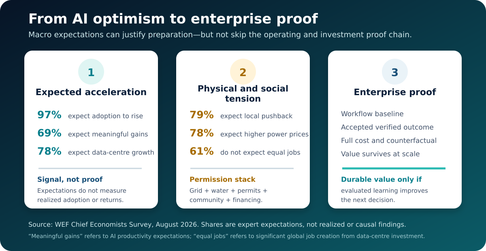
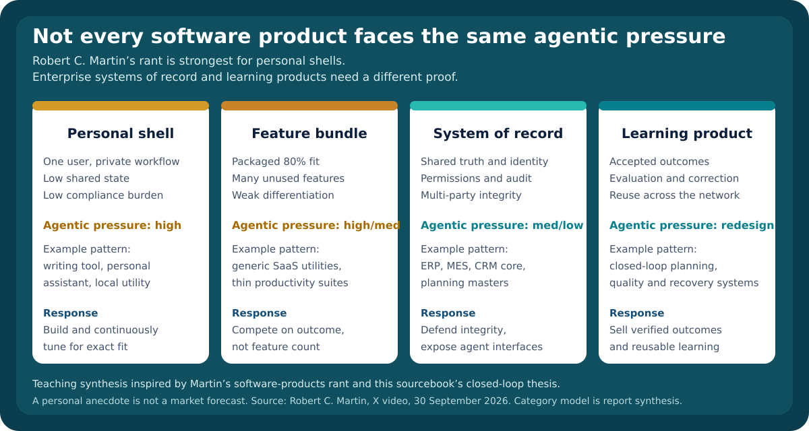
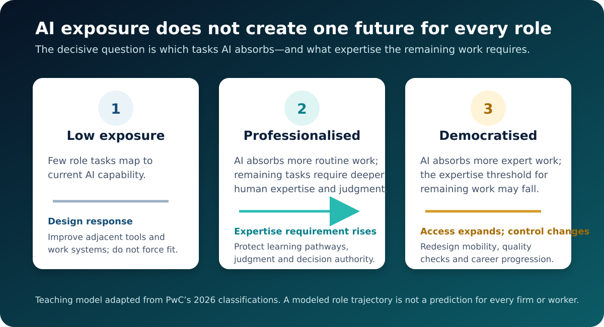
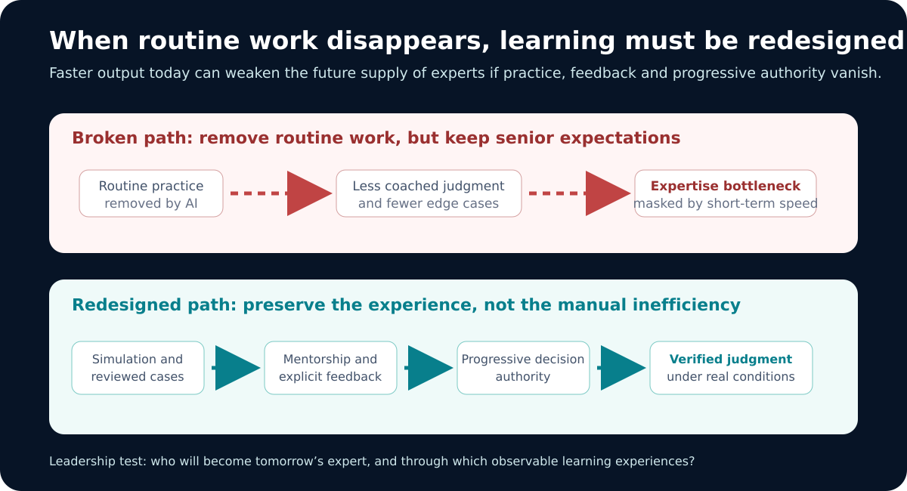
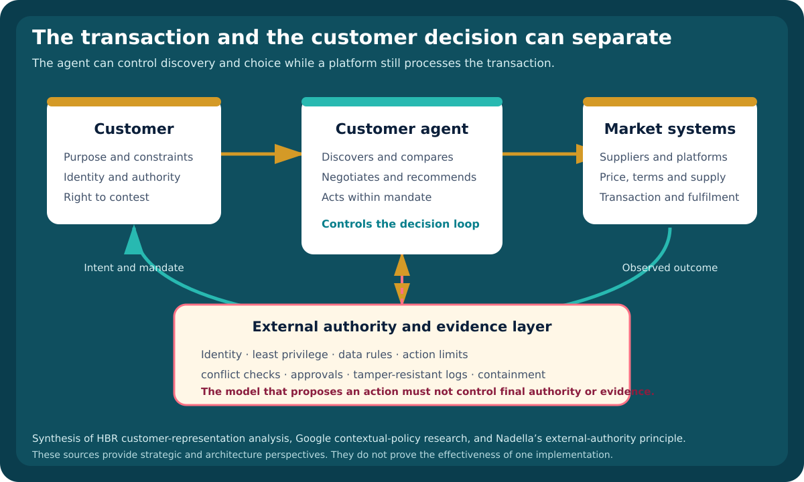
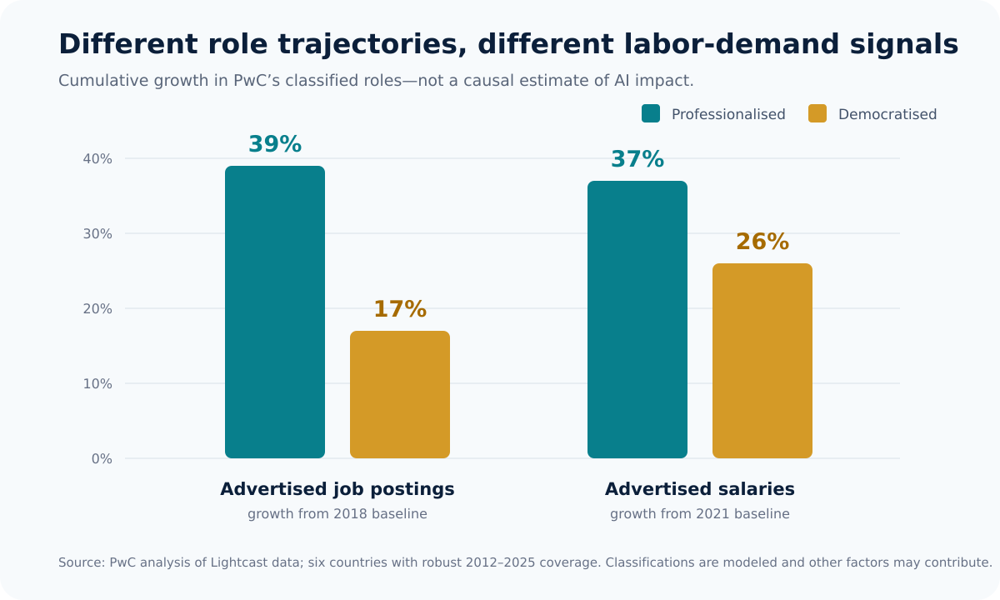
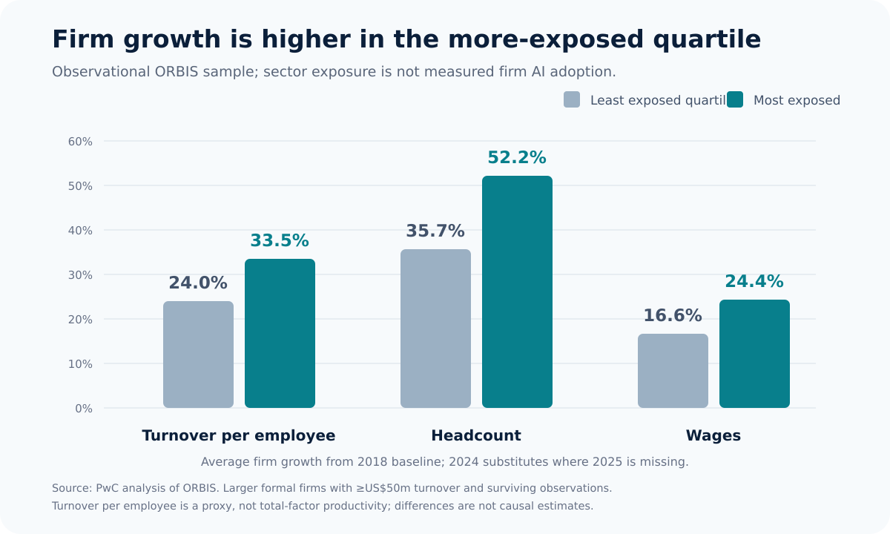

# From AI capital expenditure to evaluated organizational learning

## This sourcebook teaches about AI value, its failure to compound, and how leaders build learning enterprises

**Prepared for:** Lauro Wolff Valente Sobrinho  
**Version:** 1.8-STE, independent edition  
**Original edition:** 10 October 2026  
**Purpose:** This sourcebook is for executive teaching, leadership alignment, strategy workshops, capability building, and future presentation development.  
**Language:** ASD-STE100 Simplified Technical English (strict structural mode). Full dictionary compliance is not claimed.
**Status:** This is an evidence-grounded synthesis. It is not a financial recommendation. It is not an employer or institutional position.
**Disclaimer:** This sourcebook consolidates my opinions and multiple readings I have done. It also includes attributed source claims and new synthesis. Source claims, my views and synthesis are different forms of evidence. The report states their limits.

---

## How to use this sourcebook

This report works at four depths:

1. **Ten-minute executive read:** It includes the executive thesis, the integrated value model, and six leadership decisions.
2. **Sixty- to ninety-minute teaching session:** It includes chapters 1–5 plus one domain case.
3. **Half-day workshop:** It includes the full conceptual model, manufacturing and supply-chain cases, scorecard and diagnostic.
4. **Transformation reference:** It includes the operating model, governance, measurement, roadmap, templates and evidence ledger.

The report distinguishes ten forms of knowledge:

- **Speaker claim:** A speaker claim is a claim made in Jon Gray's Blackstone presentation, Greg Jensen's Bridgewater presentation, or Robert C. Martin's software-products rant. The report cites it with a source identifier. The report does not treat it as independently proven.
- **Attributed strategic perspective:** An attributed strategic perspective is an argument made by an identified external author such as Peter Diamandis or Robert C. Martin. It can sharpen the analysis. The report attributes it. The report does not independently validate its anecdotes, forecasts, or broad claims.
- **Company-reported case evidence:** Company-reported case evidence is a first-party account of a company's own implementation, denominator, and results. It can establish possibility and operating detail. It does not establish independent causality or transferability.
- **Observational labor-market evidence:** Observational labor-market evidence is analysis of job advertisements, company data, or modeled occupational exposure. It can identify associations, distributions, and changing demand. It does not prove that AI caused an employment, wage, productivity, or skill outcome.
- **Expert expectations survey:** An expert expectations survey is structured views from an identified expert population about likely conditions, risks, or time horizons. It can inform scenarios and priorities. It does not measure realized adoption, outcomes, or causal effects.
- **Primary research publication:** A primary research publication defines a method, reports a study, or states open research problems. Its method, population, conditions, and limitations bound every claim.
- **Sourcebook evidence:** Sourcebook evidence is a claim retained in an existing research sourcebook. It has its original evidence boundary.
- **Expressed position:** An expressed position is a position Lauro directly stated or explicitly endorsed in his working sourcebook.
- **Demonstrated position:** A demonstrated position is a principle repeatedly reflected in systems and decisions Lauro implemented.
- **Synthesis:** A synthesis is a new connection made in this report. The report does not represent it as a historical quotation or as an established causal fact.

### The central synthesis

> **AI capital expenditure becomes durable enterprise value only when intelligence is converted into governed action, verified outcomes and reusable organizational learning.**

Blackstone asks, "Where is the beef?" Its answer is return on investment. Lauro's body of work adds a second question:

> **What makes that return repeatable after the model, provider, team and business conditions change?**

Peter Diamandis adds a dynamic test. In markets where AI reduces the time and effort required to imitate products, code, or features, durable advantage depends less on a moat as a finished wall. It depends more on renewing the system before its current advantages decay. This report's synthesis is narrower than Diamandis's strongest formulation. Speed alone is not defensibility. Reinvention becomes durable only when evidence, authority, deployment, outcome verification, and reusable learning improve the quality and speed of the next move.

Microsoft's 2026 account of its own transformation adds an operating test. Broad tool access and usage did not change how work was done. Microsoft reports stronger outcomes where teams began with a business result. They simplified and redesigned an end-to-end workflow. They involved the people doing the work. They set permissions and approval thresholds. They measured operational results. They codified cases and diffused validated practices. These are selected first-party cases and self-reported survey findings. They are not independent causal studies. They provide useful implementation detail for the missing middle between access and repeatable value.

PwC's 2026 Global AI Jobs Barometer adds a workforce test. AI exposure does not imply one uniform future for work. Depending on which tasks AI absorbs, roles can become more **professionalised** or more **democratised**. Professionalised roles require deeper human expertise. Democratised roles make expert tasks accessible at a lower expertise threshold. This creates a leadership obligation beyond training people on tools. Organizations must redesign roles, quality controls, mobility, and the learning pathways through which junior employees acquire judgment. PwC's evidence is observational and model-derived. Exposure is not measured adoption. Job advertisements are not realized employment. Company-level correlations are not causal estimates of AI impact.

The World Economic Forum's September 2026 *Chief Economists' Outlook* adds a macro and infrastructure-permission test. Its surveyed chief economists strongly expect AI adoption, productivity gains, and data-centre-led growth to rise. They also expect local pushback, pressure on electricity and water prices, weaker job creation relative to capital deployment, and meaningful overinvestment risk. These are expert expectations. They are not realized or causal findings. Their value is to widen the proof burden. Capital velocity depends not only on financing and technical demand. It also depends on grid readiness, water, permitting, community legitimacy, location resilience, and workflow-level return.

Robert C. Martin's 30 September 2026 *Morning Bathrobe Rant: Software Products* adds a product-layer test. He argues that agent-assembled personal tools can replace packaged software. Packaged software does only about 80% of what a user wants. He reports building a Scrivener-like writing tool with one agent in about half an hour. This is an attributed strategic perspective and personal anecdote. It is not market proof that software products are obsolete. Its value is to force a portfolio distinction. Personal feature shells face real substitution pressure. Multi-user systems of record, regulated platforms, and evaluated learning products still require shared state, assurance, and reusable organizational learning.

Four October 2026 sources sharpen the synthesis:

- Google Research defines open problems for contextual privacy and security in agentic systems.
- Satya Nadella separates the supply of intelligence from authority over it.
- Sangeet Paul Choudary argues that customer agents can control a decision even when a platform retains the transaction.
- MIT Media Lab ImpactBench evaluates whether model behavior supports or harms human flourishing.

These sources do not prove the moat thesis. They extend its architecture, market, and human-impact tests.

# Executive summary

## The argument in one page

The AI economy has three distinct layers:

1. **The physical layer:** chips, power, data centres, networks, cooling, construction and capital.
2. **The intelligence layer:** foundation models, specialized models, inference, agents and software.
3. **The enterprise-learning layer:** trusted context, workflows, decision rights, action, verification, evaluation and institutional memory.

Blackstone’s presentation makes the investment case for the first two layers. It argues that rapidly growing enterprise use and visible operating returns create extraordinary demand for compute. Physical supply remains constrained. Its most persuasive evidence is not the headline capital expenditure. It is the set of workflow-level examples. Companies report faster processing, lower engineering effort, improved customer experience or new revenue.

Bridgewater adds a less linear lens. Greg Jensen argues that model capability can continue to improve. The commercial and capital path becomes more unstable. Enterprise adoption can deepen in selected tasks without broadening at the same rate. Cheaper open-weight competitors can compress prices. Regulation and safety constraints can slow releases. Frontier laboratories can require more capital. Investors become less willing to assume a smooth trajectory. This is a speaker and investor thesis. It is not a verified forecast. It exposes the need to separate **capability progress, adoption breadth, enterprise value and supplier economics**.

The World Economic Forum adds a second non-linear boundary. A survey can show strong expectations for more AI adoption, productivity and data-center-led growth. The same respondents foresee local opposition, electricity and water pressure, limited job creation and possible overinvestment. Infrastructure growth, social permission, enterprise return and durable advantage are different propositions with different evidence requirements.

Martin’s software-products rant adds a third non-linear boundary at the product layer. An agent can sometimes assemble a personal tool faster and closer to exact needs than a commercial package. That possibility pressures thin feature products. It does not retire systems of record, multi-party workflows or enterprise learning platforms.

Four October 2026 sources add a control boundary. Google Research proposes contextual policy as a research direction. Satya Nadella places authority, evidence, and containment outside the model. HBR adds the customer-representation problem. An agent can control discovery and choice while a platform retains the transaction. MIT Media Lab ImpactBench adds a human-impact test. Capability and task success do not show whether behavior supports agency, learning, judgment, rights, or security.

These sources extend the sourcebook synthesis. They do not prove the complete operating model.

But those examples do not yet prove that AI produces durable advantage. A fast lease process can be copied. Model access can be bought. Unit inference costs will move. A prototype can disappear when its sponsor leaves. A correction can be forgotten when the next model is introduced.

The strategic advantage emerges only when the enterprise can repeatedly do this:

```text
strategic intent
    ↓
trusted context and prior learning
    ↓
AI/human decision under explicit authority
    ↓
real action in a workflow or physical system
    ↓
verification that the action occurred
    ↓
evaluation of business outcome and full cost
    ↓
scoped correction or reusable pattern
    ↓
institutional memory that reaches the next decision
```

This is why the model is not the transformation. The loop is.

## Six leadership decisions

### 1. Change the economic unit

Do not manage AI primarily by seats, tokens, model calls or agents created. Manage it by **accepted, verified business outcomes**.

```text
true cost per accepted outcome
=
(model + compute + platform + integration + people + assurance + failure cost)
/
accepted verified outcomes
```

A cheap token can create an expensive decision. An expensive token can create a cheaper outcome.

### 2. Fund loops, not isolated use cases

The unit of transformation is an end-to-end value loop. It can sense, decide, act, verify and learn. A prediction that never changes a decision is analytics activity. A recommendation without execution is insight theatre. An action without verification is still an open loop.

### 3. Separate foundations from domain value

Fund shared capabilities and domain products together:

- identity and permissions.
- model gateway and provider routing.
- trusted data and semantic contracts.
- evaluation and observability.
- integration and tool access.
- safety, cybersecurity and compliance.
- reusable workflow patterns.
- domain-owned products with named outcome owners.

A platform without pulled-through business products becomes infrastructure theatre. A domain pilot without shared foundations becomes a stranded asset.

### 4. Preserve human accountability while granting bounded autonomy

Autonomy rises only when consequence, reversibility, evidence and feedback speed permit it. A responsible system does not place a human everywhere. It places accountable authority at the highest-impact boundary. It includes explicit permissions, escalation and rollback.

### 5. Treat evaluated learning as an asset

The proprietary asset is not accumulated transcript text. It is the governed chain:

> **sources → candidates → evaluations → corrections → retrieval feedback → improved decisions**

A correction must carry scope, authority, evidence, version and retirement conditions. A lesson that never reaches the next decision is not organizational learning.

### 6. Design for the second deployment from day one

A successful prototype is not a scaled capability. Scale requires common semantics, interfaces, controls, evaluation data, operating support, training, local configuration and benefits telemetry. The first implementation must declare what must be true for the second.

## The central distinction

| Open-loop AI | Learning enterprise |
|---|---|
| Generates an answer | Changes a decision or action |
| Measures model performance | Measures operational and business outcomes |
| Stores logs and transcripts | Promotes evaluated, scoped learning |
| Optimizes model price | Optimizes full cost per accepted outcome |
| Demonstrates a pilot | Produces a reusable product and replication package |
| Adds human review everywhere | Places accountable humans at consequential boundaries |
| Treats governance as friction | Uses governance to permit faster, safer scale |
| Buys model access | Builds context, workflow, evaluation and learning advantages |

# 1. What Blackstone’s Presentation Actually Argues

## Learning Objective

Understand the economic thesis. Do not confuse an investor narrative with independent proof of enterprise AI value.

## 1.1 The Structure of the Argument

Jon Gray organizes the presentation around four questions:

1. What changed since the previous year?
2. What can we learn from prior industrial transformations?
3. Where are we now?
4. Where are we going?

His answer is a six-step thesis:

```text
rapid model adoption
    → enterprise operating returns
    → more spending on intelligence
    → greater demand for compute
    → constrained chips, power and data centres
    → sustained infrastructure investment
```

He closes by separating the “bun” from the “beef”:

- **Bun:** trillions invested in chips, data centres and power.
- **Beef:** the return on investment generated by expanding use cases. 
 *(Blackstone presentation, 29:04–29:35)*

## 1.2 The Adoption Case

Gray presents several indicators of rapidly growing consumption and commercial scale:

- Google-related monthly token use rises from approximately **480 trillion** to **3.2 quadrillion by May 2026**. *(03:17–03:36)*
- Anthropic and OpenAI reach approximately **$105 billion of combined run-rate revenue** as of the July shown in the presentation. *(03:49–04:01)*
- Across approximately **1,400 Blackstone-linked portfolio companies, GP-stakes companies and borrowers**, annualized Anthropic expenditure rises from **$25 million in September 2025 to $525 million**, or 21-fold. *(04:10–04:39)*

These numbers demonstrate the claim that consumption is accelerating. They do not by themselves demonstrate net business value. The ROI examples are therefore the more important part of the presentation.

## 1.3 The Capital-Expenditure Case

Gray describes extraordinary infrastructure investment:

- Five hyperscalers: **$415 billion of capital expenditure last year and $820 billion this year**, which he equates to approximately **2.5% of US GDP**. *(05:30–05:48)*
- Blackstone data-centre leasing: **1 GW in 2024, 2 GW in 2025 and at least 6 GW expected in 2026**. *(05:51–06:10)*
- The 6 GW is linked to nearly **$100 billion** of data-centre capital expenditure, plus “a couple hundred billion dollars” of tenant chips. *(06:08–06:18)*
- Utility capital expenditure: approximately **$800 billion over the preceding five years**, expected to nearly double over the next five. *(08:00–08:10)*

The strategic lesson is not simply that spending is large. AI is no longer only a software market. It is an industrial system. Its economics include energy, land, permits, hardware, construction and geopolitics.

## 1.4 The Workflow-Level ROI Case

The most useful claims are attached to specific workflows:

| Case study | Speaker claim | Why it matters | Timestamp |
|---|---|---|---|
| Phoenix Tower | Lease processing is five times faster. $4 million invested and $4.5 million annual benefit. described as a 100%+ annual return. | A bounded administrative workflow with a financial baseline. | 16:09–16:28 |
| Enverus | A code-repair process produces an 18× return on model-company expenditure. | Model spend follows demonstrated engineering productivity. | 16:30–16:46 |
| Tricon | Rental applications are processed 90% faster. | Customer experience and cycle time, not only internal cost. | 16:47–16:57 |
| Chamberlain/MyQ | An analogue garage-door business developed an AI-visualization product with $40–50 million current run-rate revenue and a CEO forecast of $500 million within five years. | AI can create new revenue and product categories, not merely productivity. | 17:05–17:53 |
| Blackstone legal/compliance | Marketing reviews are described as 50% more efficient. | Professional workflow compression. | 18:02–18:08 |
| Blackstone portfolio intelligence | Timelines are described as 99% shorter. | AI can compress research and synthesis, although the exact task and quality baseline require inspection. | 18:10–18:19 |

### Teaching Point

These are useful case signals, not general business cases. Each still requires:

- the pre-AI process baseline.
- full implementation and operating cost.
- output-quality and risk measures.
- adoption and exception rates.
- causal attribution.
- evidence that benefits persist at scale.

## 1.5 The Historical Analogy

Gray compares the present moment with 1870–1900. He cites large increases in labour productivity, GDP, manufacturing output and equity markets. He explicitly says he is not forecasting an identical outcome. *(11:30–12:19)*

He then introduces the essential counterweight: approximately **200 railroads** entered bankruptcy or insolvency during the same transformation. *(12:22–12:44)*

His distinction is that historical railway and telecom capacity was often built with high leverage ahead of demand. Today’s AI infrastructure is contracted in response to demand and often by low-leverage counterparties. *(12:45–13:22)*

### Correct Lesson

A technology can transform the economy while destroying capital in many individual investments. Directional correctness does not guarantee asset-level returns.

## 1.6 The Physical Bottleneck

Gray’s three forward beliefs are:

1. use cases will proliferate.
2. productivity gains will increase intelligence consumption.
3. the binding constraint will be the physical world: chips, power and data centres. *(22:09–22:43)*

He supports the constraint argument with claims that:

- some large turbine delivery slots extend to **2030–2031**. *(23:23–23:30)*
- hyperscaler capital expenditure grew **ninefold in five years**, while chip-company capital expenditure had not doubled. *(23:44–24:02)*
- an “AI factory” requires approximately **$55 billion per gigawatt** across power, data centres and chips. *(24:03–24:25)*

## 1.7 The Disruption Case

Gray says Blackstone’s greatest concern is underestimating technological disruption. *(24:36–24:46)*

He notes that software, professional-services and information-services valuations compressed even when current operations remained sound. Markets repriced uncertainty about future defensibility. Private-equity software deals are described as falling **66%**. *(24:47–25:20)*

His retail analogy separates companies destroyed by e-commerce from Walmart, Costco and TJ Maxx, which retained differentiated value propositions. He expects stronger white-collar businesses to retain vital systems of record. He expects them to move from charging for seats to charging for outcomes. *(25:35–26:12)*

## 1.8 The Risk Case

The presentation names four principal risks:

- cyber incidents involving financial or critical infrastructure.
- technology shifts in edge or space-based compute.
- geopolitical concentration, including the claim that 90% of advanced semiconductors are produced in Taiwan.
- excessive valuations, including pre-revenue companies valued around $10 billion. *(27:15–28:48)*

## 1.9 What the Presentation Establishes and What It Does Not

### It provides credible strategic signals that:

- AI use and infrastructure spending are rising quickly.
- some companies report material workflow-level benefits.
- AI can create products and revenue, not only efficiency.
- power, chips and construction are strategic constraints.
- software and professional-services economics are repriced.
- returns and disruption will be uneven.

### It does not establish that:

- all stated portfolio returns use comparable or complete accounting.
- AI caused macro productivity, margin or earnings changes.
- current infrastructure valuations are attractive.
- today’s demand cannot later be overbuilt.
- employment effects will be benign across roles and regions.
- every firm can reproduce the selected case studies.
- model access alone creates a moat.

---

# 2. The stronger enterprise thesis

## Learning objective

Connect macro AI spending to the enterprise mechanisms that actually create and preserve value.

## 2.1 The missing middle

Most AI narratives jump from models and infrastructure directly to business outcomes:

```text
compute + models → value
```

The missing middle is the operating system of the enterprise:

```text
compute and models
    + trusted context
    + workflow integration
    + decision rights
    + bounded execution
    + verification
    + evaluation
    + organizational memory
    = repeatable business value
```

This report’s main synthesis is that Blackstone’s ROI argument and Lauro’s closed-loop argument are not competing explanations. They operate at different levels:

- Blackstone explains **why demand and investment can persist**.
- The closed-loop thesis explains **why some enterprises will turn that investment into compounding advantage while others generate activity without learning**.

### Three propositions that require different proof

| Proposition | Appropriate evidence | What does not prove it |
|---|---|---|
| AI demand can justify infrastructure investment. | Contract quality, utilization, capacity constraints, customer credit, asset economics and scenario resilience. | Aggregate capital expenditure or token growth alone. |
| A specific enterprise can earn attractive returns from AI. | Workflow baseline, full cost, accepted outcome, causal comparison and persistence after handover. | Provider spend, user activity or a selected pilot anecdote. |
| An enterprise can build durable advantage from AI-enabled learning. | Proprietary context, embedded workflow position, decision/action rights, measured reuse, replication and sustained improvement versus alternatives. | Model access, stored conversations or a knowledge repository by itself. |

## 2.2 The complete AI value chain

| Layer | Core question | Typical assets | Failure if missing |
|---|---|---|---|
| Physical capacity | Can intelligence be produced and delivered? | Power, chips, data centres, networks, cooling | Scarcity, latency, price and concentration risk |
| Model capability | Can the task be performed technically? | Frontier, small, specialized and open-weight models | Insufficient quality or capability |
| Enterprise context | Does the system understand the relevant reality? | Data, semantics, source systems, policies, history | Fluent but irrelevant or unsafe output |
| Orchestration | Can models, tools, people and systems work together? | Identity, permissions, workflows, APIs, agents | Disconnected copilots and stalled handoffs |
| Decision and action | Can intelligence change the real process? | Decision rights, work queues, tools, automation | Insight theatre |
| Verification | Did the action actually occur and meet acceptance criteria? | Read-back, tests, controls, reconciliations | Fabricated completion and silent failure |
| Evaluation | Did the change improve value at full cost? | Baselines, counterfactuals, outcome telemetry | Activity mistaken for progress |
| Learning | What must govern the next similar decision? | Corrections, versions, scope, retrieval feedback | The organization pays to relearn |
| Adaptation | Does the operating system improve? | Policy, process, architecture, training, incentives | Static automation rather than transformation |

## 2.3 The economic flywheel and the learning flywheel

The AI economy contains two flywheels.

### Economic flywheel

```text
better capability
→ more useful tasks
→ more consumption
→ more model and infrastructure investment
→ lower cost / greater capability
→ still more useful tasks
```

### Enterprise-learning flywheel

```text
better context
→ better decision
→ verified action
→ measured outcome
→ scoped correction
→ reusable learning
→ better context for the next decision
```

The first can expand an industry. The second determines whether an individual enterprise develops a durable advantage.

## 2.4 The “bun, beef and compounder” model

A useful teaching extension of Blackstone’s metaphor is:

- **The bun:** physical and digital capital.
- **The beef:** verified operating and financial return.
- **The compounder:** evaluated learning that makes later decisions better and lowers the cost of future value.

An organization can buy the bun and occasionally find the beef without creating a compounder. That is the pattern behind many pilots: useful once, not reusable.

# 3. AI economics for Digital & IT

## Learning objective

Replace misleading AI cost measures with a financial model that links to accepted outcomes, risk, and option value.

## 3.1 Bridgewater’s critical-time thesis

Bridgewater’s 13:26 presentation, *A Critical Time for AI*, uses an investor view with Bridgewater’s experience as an AI practitioner. Greg Jensen’s argument is not that AI progress has stopped. His argument is that strong technical progress can coexist with a difficult financing, adoption, and regulatory transition.

| Presentation claim | Timestamp | Evidence-safe interpretation for enterprise leaders |
|---|---:|
| AI has become central to macro, market and Bridgewater operating discussions. | 00:04–01:30 | The source frames AI as an investment variable and an operating capability. It does not quantify economy-wide impact. |
| Model capability continues to scale, with depth in selected areas described as superhuman. | 01:33–04:39 | Treat this as Jensen’s assessment. Capability in selected tasks does not prove broad workflow reliability or economic value. |
| Frontier labs can face slowing revenue growth, rising competition, regulation and very large capital needs simultaneously. | 02:08–03:12. 06:33–07:39. 10:19–12:02 | Supplier capability and supplier economics can move in different directions. Forecasts and slide figures remain Bridgewater estimates. |
| Adoption depth is advancing faster than adoption breadth. | 02:21–02:40. 07:04–07:39 | Jensen says coding and mathematical uses are deep while enterprise adoption remains relatively narrow. This is an assessment from Jensen, not a measured transformation rate. |
| Cost per token is a misleading comparison. task completion cost and quality matter more. | 08:09–09:20 | This supports task-specific evaluation and full cost per accepted outcome. Bridgewater’s internal benchmark does not have external validation. |
| Different model classes have different value. cheaper models can work for some tasks while frontier intelligence retains an advantage elsewhere. | 07:43–10:06 | Manage a governed model portfolio rather than a winner-takes-all standard. Re-test because price and quality rankings change. |
| More capable models expand cyber, biological and geopolitical hazards, increasing pressure for regulation of both models and laboratory environments. | 05:12–06:28 | Capability investment must include containment, identity, permissions, monitoring and incident response. The specific incident account in the transcript requires independent verification before factual reuse. |
| Bridgewater expects major internal transformation in three to five years while warning that the market path will be bumpy. | 12:06–13:23 | Separate the long-term transformation hypothesis from the timing and valuation of individual investments. |

The presentation’s most useful teaching distinction is that AI does not follow one curve. At least five curves interact:

```text
technical capability          ↑ rapidly but unevenly
adoption depth                ↑ in selected workflows
adoption breadth              ↑ more slowly
capital requirement           ↑ sharply at the frontier
regulation and control burden ↑ with capability and consequence
```

An enterprise can therefore face all of the following at once: better models, lower prices for some tasks, rising total consumption, concentrated workflow value, greater control cost and supplier instability.

Jensen makes an explicit capital-pressure argument. The presentation cites approximately **$567 billion** that enters the AI ecosystem in 2025. It says **62%** came from operating cash flow. It identifies approximately **$214 billion** from outside the ecosystem. It estimates that **$643 billion** will be needed in 2026 and **$1 trillion** in 2027. *(10:46–11:16)* These are Bridgewater slide and speaker estimates. Automated captions transcribed these estimates. They are not independently verified market totals. Investment-grade use must inspect the original slide and its sources.

### What Bridgewater establishes—and what it does not

The presentation provides a coherent investor-practitioner hypothesis. It explains why transformation can be real while market expectations and supplier financing remain fragile. It does **not** independently establish the accuracy of the capital forecasts. It also does not establish the reported internal benchmark, the timing of regulation, the described safety incident, or the predicted three-to-five-year organizational transformation.

## 3.2 From predictable capacity to elastic intelligence

Traditional Digital & IT economics often center on:

- users and licenses
- applications and infrastructure
- projects and releases
- relatively predictable consumption

AI introduces a portfolio of elastic intelligence:

- unit prices can fall while total consumption rises
- each workflow can require a different capability level
- retries and tool calls create hidden consumption
- performance and pricing change rapidly
- output quality is probabilistic
- assurance and human review can dominate inference cost
- a provider change can alter risk, behavior and data exposure

## 3.3 The correct unit of economics

The minimum formula is:

```text
cost per accepted verified outcome
=
(inference
 + platform
 + orchestration and tool calls
 + integration
 + data preparation
 + human review
 + evaluation and assurance
 + operations and support
 + expected failure and recovery cost)
/
accepted verified outcomes
```

“Accepted” matters because generated output is not automatically usable. “Verified” matters because the system must establish that the artifact or state is valid and that a claimed action occurred.

## 3.4 Why token prices mislead

Token prices exclude:

- different token volumes for the same task
- retries and long reasoning paths
- tool and retrieval calls
- latency and queueing
- integration and migration
- quality review and correction
- downstream rework
- failure consequence
- security and compliance
- provider-switching cost

The approved editorial principle states:

> **Make the model revisable while validated lessons stay connected to the workflow. Models will keep changing, but the same operational lesson must cost us once.**

## 3.5 A governed model portfolio

There is unlikely to be one optimal enterprise model. A rational portfolio can contain:

- frontier models for demanding reasoning
- smaller commercial models for routine work
- open-weight or self-hosted models for privacy, control, volume or resilience
- specialized models for industrial, scientific or engineering tasks
- deterministic software where probabilistic AI is unnecessary

The routing objective is:

> Select the least costly model and architecture that reliably satisfy the task’s quality, latency, privacy, sovereignty and risk requirements.

## 3.6 Shared foundation versus workload cost

### Shared foundation

- model gateway and provider policy
- identity, permissions and agent credentials
- retrieval and trusted data services
- orchestration and reusable tools
- evaluation framework
- security and compliance
- observability and cost telemetry
- rollback, fallback and incident handling

### Workload-specific cost

- inference and task-specific tools
- workflow integration
- domain-data preparation
- product team and process owner time
- human validation
- process and role change
- operating support
- local calibration and replication

The funding rule is **platform plus pulled-through products**. Shared capabilities require demand from named value loops. Domain products must use shared controls. An exception must have a justification.

## 3.7 Four dimensions of value

Assess every AI investment across these four dimensions:

1. **Efficiency:** cost or lead-time reduction for existing work.
2. **Effectiveness:** improved quality, decisions, reliability or safety.
3. **Capacity:** more output without proportional resource growth.
4. **Option value:** reusable data, evaluation, integration, semantic or learning capability that makes future loops cheaper or faster.

Option value is real only when the asset is governed, discoverable, reused and measured. Unused platform code is not option value.

## 3.8 Evidence-gated funding

| Gate | Question | Required evidence |
|---|---|---|
| Explore | Can the technology perform the task? | Test set, capability result, known failure modes |
| Validate | Does it improve the actual workflow? | Live or representative workflow evidence, user acceptance, baseline comparison |
| Industrialize | Is it secure, reliable and supportable? | Architecture, controls, tests, ownership, monitoring, fallback |
| Scale | Does value survive broader deployment? | Replication result, marginal deployment cost, adoption and outcome telemetry |
| Optimize | Is this the best model and architecture now? | Task-specific evaluation, full cost, quality, latency, risk and switching analysis |

Technical feasibility alone is not an investment case.

## 3.9 A dual-speed investment model

Blackstone and Bridgewater create a productive tension. Blackstone emphasizes demand, physical scarcity and enterprise ROI examples. Bridgewater emphasizes the possibility of an air pocket created by high expectations, capital intensity, uneven adoption, competition and regulation. Both can be true.

The investment model must run at different speeds:

| Portfolio layer | Default horizon | Funding logic | Reassessment trigger |
|---|---|---|---|
| Durable foundations | Multi-year | Fund identity, semantics, integration, evaluation, observability and controls that remain useful across models. | Architecture obsolescence, low reuse or a better simpler control. |
| Model and supplier options | Quarterly or event-driven | Preserve competition and route tasks based on current evaluation. Avoid irreversible dependence where material. | Material price/performance change, provider risk, regulation or data-boundary change. |
| Domain value loops | 30–90-day evidence increments | Increase funding only when accepted workflow outcomes survive full-cost accounting. | Failure to improve the baseline, weak adoption, excessive review or unsafe exceptions. |
| Frontier experiments | Small, time-boxed options | Buy learning about new capability. Do not embed it prematurely in critical operations. | Capability threshold reached, evidence of value, or option expiry. |

This is not an argument to avoid commitment. It is an argument to make long commitments to durable enterprise capabilities and shorter, revisable commitments to volatile model and supplier choices.

## 3.10 Macro acceleration needs an infrastructure permission stack

The World Economic Forum’s *Chief Economists’ Outlook: September 2026* used policy research, consultations, and a survey of leading public- and private-sector chief economists. The survey took place from **4 to 20 August 2026**. It reports a near-consensus expectation that AI adoption will increase over the next 12 months (**97%**) and a majority expectation of meaningful AI productivity gains (**69%**). It also reports that **78%** expect data-centre investment to drive a significant share of global growth.

Those expectations coexist with substantial physical, distributional and financial tension:

- **79%** expect significant local-community pushback against data-centre expansion
- **78%** expect materially higher average electricity prices for other consumers
- **58%** expect materially higher average water prices for other consumers
- **61%** do not expect data-centre investment to drive a significant share of global job creation
- respondents are divided on whether investment will exceed future demand: **42% agree or strongly agree, 44% disagree or strongly disagree and 14% are neutral**

<figure class="visual">

<figcaption><strong>Figure 3.1 — From AI optimism to enterprise proof.</strong> WEF’s percentages describe surveyed chief economists’ expectations, not realized adoption, causal productivity effects or asset-level returns. The sourcebook adds the enterprise proof stage as synthesis.</figcaption>
</figure>

The investment implication is a **permission stack**, not a forecast about whether to build AI infrastructure:

> **Permission chain:** credible demand → financeable asset and downside resilience → power, water and network capacity → permitting and community legitimacy → enterprise workflow adoption → accepted verified outcome → full-cost return → reusable organizational learning

Each link can fail independently. High aggregate demand does not make every location viable. A contribution to GDP does not establish job quality, distributional benefit or local acceptance. A technically utilized data centre does not prove that its enterprise customers earn attractive returns. A productive workflow does not create durable advantage unless its correction and learning improve the next decision.

| Signal | Appropriate use | What it does not prove | Decision response |
|---|---|---|---|
| Strong expectations for adoption and productivity | Prepare capacity, skills and operating options. | Realized adoption, causal productivity or a smooth timing curve. | Use scenarios and staged commitments rather than a single-point forecast. |
| Expected data-centre contribution to growth | Test infrastructure demand and regional spillovers. | Attractive economics for every asset, provider or customer. | Stress-test utilization, customer concentration, model efficiency, refinancing and alternative use. |
| Expected electricity, water and community pressure | Treat location and social licence as design variables. | Identical effects in every market or cooling architecture. | Model grid connection, price pass-through, water scarcity, benefit-sharing and permitting before commitment. |
| Weak expected job creation relative to capital | Examine who captures value and who bears cost. | No employment benefit anywhere. | Measure local employment, tax, supplier and household effects rather than relying on aggregate capex. |
| Split view on overinvestment | Preserve reversibility and downside resilience. | That a bubble exists or that all demand is durable. | Separate technology conviction from asset price, financing structure and entry timing. |

The report does not disclose one explicit respondent count in the extracted methodology text. Percentages must therefore remain as shares of surveyed chief economists. Do not infer the denominator from rounded results or the contributor list.

# 4. The nine-layer business-grade AI loop

## Learning objective

The learning objective is to understand the full architecture that connects AI capability to organizational learning.

## 4.1 The loop

The author's working model defines nine layers.

| Layer | Question | Required artifact | Example measures |
|---|---|---|---|
| 1. Strategic intent | What outcome matters and why? | Outcome statement, baseline, target, guardrails | Addressable value, strategic relevance |
| 2. Trusted context | Which evidence, constraints and prior learning apply? | Source map, semantic contract, data-quality status | Freshness, provenance, retrieval relevance |
| 3. Orchestration | Which people, agents, tools and systems participate? | Workflow and handoff contract | Handoff success, latency, queue age |
| 4. Bounded decision | Who decides under which policy? | Decision rights, thresholds, acceptance criteria | Override and escalation rates |
| 5. Execution | What changes in the real world? | Action record, tool result, transaction ID | Action completion, reversibility |
| 6. Verification | Did the action occur and is the state valid? | Read-back, test, reconciliation, evidence receipt | Verified completion rate |
| 7. Evaluation | Did it improve value at full cost? | Baseline comparison, counterfactual, cost record | Net value, cost per accepted outcome |
| 8. Institutional learning | What becomes reusable? | Scoped correction, version, owner, expiration | Reuse and retrieval lift |
| 9. Adaptation | What changes next cycle? | Updated policy, process, model routing or training | Improvement over subsequent cycles |

## 4.2 Failure modes by broken link

- **No intent:** Automation has no purpose.
- **No trusted context:** Output is fluent but irrelevant.
- **No orchestration:** Copilots remain isolated and pilots remain disconnected.
- **No decision rights:** Ambiguity and shadow accountability exist.
- **No execution:** Insight theater occurs.
- **No verification:** Fabricated completion and silent failure occur.
- **No evaluation:** Activity repeats without learning.
- **No institutional memory:** The organization pays to relearn.
- **No adaptation:** Dashboards replace transformation.

## 4.3 The maturity ladder

| Level | Description | Typical proof | Main risk |
|---|---|---|---|
| 0. Generated | AI produces content or a prediction. | Output exists. | People mistake output for value. |
| 1. Grounded | Output uses authorized context and sources. | Provenance and retrieval trace exist. | The sources are correct, but the workflow is wrong. |
| 2. Decision support | A named owner uses the output in a real decision. | Acceptance, override, and reason exist. | There is no execution evidence. |
| 3. Execution | AI or a person acts through the workflow. | A transaction or a state change occurs. | Action occurs but no one makes sure that it is valid. |
| 4. Verified | Verification makes sure that the action and the resulting state are valid. | Read-back, test, or reconciliation occurs. | People mistake a success proxy for the outcome. |
| 5. Evaluated | Evaluation compares outcome and full cost with a baseline. | Business and risk evidence exists. | Learning remains local. |
| 6. Learning | A validated correction is reusable in a later case. | Retrieval and changed-decision evidence exists. | Learning becomes stale or over-broad. |
| 7. Adaptive network | Learning replicates across products, teams, plants or markets. | Faster second deployment and sustained value exist. | People ignore local context when they scale. |

## 4.4 Closed loop does not mean full autonomy

A human decision owner can close a loop. The defining property is feedback that changes future behavior, not the absence of people.

Autonomy depends on:

- consequence
- reversibility
- policy stability
- quality and freshness of context
- speed and reliability of outcome feedback
- ability to detect and contain failure

# 5. Evaluated organizational learning as the moat

## Learning objective

Distinguish genuine organizational learning from archives, transcripts, model memory and untested rules.

## 5.1 The operating hypothesis

Lauro’s editorial thesis states:

> **The learning is the next IP. Everything else in the AI stack gets cheaper.**

The more precise hypothesis is:

> A durable advantage can emerge when an organization repeatedly converts evidence and corrections into scoped, governed learning. This learning improves later decisions at a net benefit greater than its full maintenance cost and better than simpler alternatives.

This is deliberately a hypothesis, not a guarantee.

## 5.2 What the asset is not

The asset is not:
- raw conversation history.
- a large vector database.
- an ungoverned knowledge graph.
- prompt libraries without outcome evidence.
- model fine-tuning without task-level evaluation.
- logs retained but never retrieved.
- rules that persist after their context expires.

A graph written once and never queried is an expensive table. A lesson captured but never reused is not organizational learning.

## 5.3 The evaluated-learning chain

```text
source evidence
→ candidate interpretation or action
→ evaluation
→ human or system correction
→ correction record with scope and authority
→ retrieval in a later relevant case
→ changed decision or action
→ improved outcome
→ confirmation, refinement or retirement
```

The chain must answer:

1. What was the source?
2. What was inferred?
3. Who corrected or approved it?
4. Under what context does the correction apply?
5. What version was active?
6. Was it retrieved when a relevant case returned?
7. Did it change the decision?
8. Did the changed decision improve the outcome?
9. Is the learning still valid and worth maintaining?

## 5.4 Case study: the quality hold

A production system says release. A torque trace suggests hold. An engineer keeps the order on quality hold and records the correction, including part revision, station or programme, lot or condition and acceptance criteria.

Weeks later, a similar order reaches review.

The system must not simply retrieve “hold.” It must determine:
- whether the earlier correction applies.
- who had authority to hold, release or override.
- whether the authorized decision reached the quality-hold control.
- whether the action protected quality without unacceptable delivery or cost consequences.

If the learning is stable and repeatable, the best solution can become a simpler rule or interlock. Keep AI only where context still requires judgment.

### Teaching distinction

The goal is not to preserve AI. The goal is to preserve value. A successful AI loop can prove that AI is no longer necessary for part of the process.

## 5.5 Case study: supplier pattern and contract price

A buyer recommends a contract price but misses a supplier pattern mentioned by an engineer in an undocumented meeting. When the supplier returns six months later, the organization risks paying for the same lesson again.

A learning system converts the earlier correction into a governed record:
- source and evidence.
- supplier and contract scope.
- price-floor implication.
- owner and authority.
- retrieval trigger.
- version and expiry.
- evidence that the record influenced the next recommendation.

The advantage is not the meeting note. It is the chain that causes an authorized correction to govern a later decision.

## 5.6 Conditions under which learning becomes a moat

Evaluated learning is defensible only if these conditions hold:

- Decisions repeat often enough for reuse.
- Proprietary context materially improves decisions.
- Outcomes can be observed within a useful time.
- Lessons are difficult for competitors to reproduce.
- Corrections are scoped and governed.
- Retrieval is reliable.
- Obsolete learning is retired.
- Full maintenance cost is lower than avoided loss or created value.
- The organization changes behaviour, not only documentation.

If decisions are rare, outcomes are unobservable, or learning becomes public quickly, the moat is weak.

The fuller formulation is:

```text
potential durable advantage
= proprietary context and data rights
+ embedded workflows and distribution
+ governed decision and action rights
+ measured evaluated learning
+ replication capability
+ legitimate switching and friction costs
+ capital and deployment capacity
+ trusted relationships and brand where consequential
```

Evaluated learning is a crucial compounding mechanism. It is not necessarily the whole moat. A competitor can copy a lesson but cannot reproduce the data rights, installed workflow, authority, customer relationship or replication capability around it.

### From static moat to governed renewal system

Peter Diamandis wrote an X Article on 24 September 2026. The article is *What Counts as a Moat in the Age of AI?*. He argues that AI compresses the time and effort to imitate patents, code, features, distribution and switching-cost advantages. He proposes three more durable sources of advantage:

1. Speed of reinvention is what he calls the organization's metabolic rate.
2. Capital velocity is the ability to finance and deploy scarce capacity quickly into existing demand.
3. Brand is retained most strongly where identity, status or trust remains consequential.

These are attributed strategic claims. They are not universal findings. The article relies on founder anecdotes, podcast statements and forward-looking examples. It does not establish that patents, CUDA, switching costs, network effects or distribution no longer matter across industries.

The useful learning is more precise:

> **A static advantage becomes a head start when imitation and market change move faster than the organization can renew it.**

The report therefore distinguishes three velocities:

| Velocity | Question | Failure mode |
|---|---|---|
| **Learning velocity** | How quickly does evidence become a validated correction that improves a later decision? | Fast activity with no retained learning. |
| **Reinvention velocity** | How quickly can the organization redesign and deploy a better product, workflow, business model or operating position? | Pivots without evidence, absorption capacity or repeatable execution. |
| **Capital velocity** | How quickly can capital, infrastructure and commercial demand be committed to the next position? | Fast capital deployment into weak economics, stranded assets or an unverified market. |

These velocities complement one another. They do not replace one another. Evaluated learning increases the quality of reinvention. Capital capacity increases the feasible scale and speed of deployment. Trusted relationships, legal rights, physical assets, ecosystems and switching frictions can still slow imitation. Durable advantage is the governed system. This system renews these assets faster than they decay. It does not outrun evidence or customer value.
### Software products under agentic substitution pressure

On 30 September 2026, Robert C. Martin published a short X video titled *Morning Bathrobe Rant: Software Products*. 
Martin argues that many software products can become unnecessary. 
An AI agent can build a personal tool that does exactly what the user wants. 
A commercial product does about 80% of what the user wants. 
It also includes features that the user does not want. 
He used one agent, Grok, to inspect Scrivener. 
He assembled a simpler book-writing tool in about half an hour. 
He then tweaked and tuned it as needs changed. 
He fears for software-product companies. 
He cheers for users who can obtain exactly the tools they want.

This is an attributed strategic perspective. 
One personal anecdote backs it. 
It is useful as a product-layer challenge. 
It is not independent market evidence. 
It does not prove that software products are already obsolete. 
It does not prove that half-hour agent builds are typical or complete. 
It does not prove that agents can replace multi-user enterprise systems in the same way.

The useful learning is more precise:

> **Agentic assembly can substitute for some personal and small-team feature shells. 
> It does not erase the need for shared systems of record, multi-party workflows, regulated assurance or evaluated organizational learning.**

Blackstone’s seats-to-outcomes pressure and Diamandis’s software-cloning pressure apply here as the same family of questions. 
Visible feature lists become easier to imitate or assemble. 
Durable product value must move toward shared state, decision rights, verified outcomes and reusable learning. 
Or it must accept competition from continuous personalization.

<figure class="visual">

<figcaption><strong>Figure 5.1 — Agentic pressure is not uniform across software categories.</strong> Martin’s rant is strongest for personal shells. Enterprise systems of record and learning products require a different proof burden. Category model is report synthesis. the rant is the attributed challenge, not a market census.</figcaption>
</figure>

| Software category | Agentic pressure | What still requires product or platform strength |
|---|---|---|
| **Personal productivity shell** | High | Little shared state. low compliance burden. one-user convenience |
| **Commodity feature bundle** | High to medium | Packaging and support until agent reliability is proven. still weak if value is only feature count |
| **Multi-user system of record** | Medium to low | Shared truth, identity, permissions, integrity, audit and continuity |
| **Workflow and decision product** | Medium | Decision rights, integrations, recovery and evaluation |
| **Outcome and learning system** | Competitive redesign | Accepted outcomes, telemetry, correction memory, diffusion and full-cost economics |

Enterprise buyers and software owners must ask five questions before they treat “the agent will build it” as a strategy:

1. Make sure that the workflow optimizes one person or a network of roles.
2. Make sure that the shared state remains consistent across users, sites or counterparties.
3. Make sure that you identify unacceptable failure and the accountable person.
4. Make sure that you calculate the full cost to build, secure, maintain, recover and retire the agent-built tool.
5. Make sure that the result creates reusable organizational learning, not only private convenience.

For industrial and multi-business corporations, apply portfolio discipline rather than product nihilism. 
Protect and modernize systems of record. 
Redesign workflow products around accepted outcomes. 
Expect thin feature shells to face substitution. 
Do not confuse a successful personal writing-tool anecdote with an ERP, MES, TMS, planning or quality-system replacement case.

## 5.7 Learning metrics

Track at least:

- percentage of material decisions linked to evidence
- percentage with an observed outcome
- correction capture rate
- relevant-case retrieval rate
- retrieval precision and false-positive rate
- percentage of retrieved lessons that change the decision
- outcome lift when prior learning is used
- time from local validation to reuse elsewhere
- stale-learning and retirement rate
- full cost of review and maintenance
- cost per accepted outcome before and after reuse

For the dynamic-moat question, also track:

- time from a material external change to an owned strategic decision
- time from an approved correction to deployed change
- percentage of major reinvention decisions with a baseline, counterfactual and accepted outcome
- reinvention success rate after transition and operating costs
- capital-reallocation lead time and post-deployment utilization
- concentration of advantage in one decaying model, provider, interface, patent or channel
- whether each material advantage is strengthening, stable, eroding or being deliberately replaced

## 5.8 Human–AI learning is bidirectional

Microsoft frames organizational learning as movement in both directions. AI can help people explore, build skills and learn in the flow of work. People supply ambition, context, judgment, quality standards and corrections. These make AI-supported work more useful.

The important boundary is that this does not necessarily mean a foundation model updates its weights from every interaction. The enterprise learning system can improve through:

- better governed context and semantics
- scoped correction records
- revised evaluations and acceptance criteria
- new policies, permissions and escalation rules
- improved workflow design
- updated retrieval, examples and tools
- human skill and judgment developed through practice

The two-way loop is therefore:

```text
AI-supported work
→ human judgment and accepted outcome
→ correction, requirement or new pattern
→ governed update to context, evaluation, policy or workflow
→ better-supported human and agent work
```

Microsoft also argues that organizations must retain control of the institutional knowledge created through this loop. They must avoid dependence on one model provider. The operational implication is not perfect model interchangeability. It is to keep semantics, corrections, evaluations, authority, outcome data and reusable learning inside enterprise-controlled boundaries. Model choices remain proportionately revisable.

## 5.9 Customer representation creates another learning loop

An HBR article by Sangeet Paul Choudary argues that customer agents can separate the decision from the transaction.

A marketplace can retain supply and checkout. A customer agent can still control discovery, comparison, negotiation, and choice.

This is an attributed strategic perspective. It is not legal authority or causal proof.

The strategic learning loop becomes:

```text
customer purpose and constraints
→ agent-supported discovery and comparison
→ bounded decision and action
→ transaction and fulfilment
→ observed customer outcome
→ correction and next decision
```

The strongest position is not traffic alone. It is the trusted right to represent the customer and learn from verified outcomes.

This position creates duties. The agent must show authority, sources, conflicts, material terms, and the reason for each consequential action.

The enterprise must also protect customer choice. It must not convert personalized representation into hidden steering or supplier favoritism.

Track at least:

- percentage of decisions with explicit customer authority
- percentage of recommendations with source and conflict evidence
- rate of accepted, rejected, or contested agent decisions
- outcome quality after the transaction
- customer correction and appeal rate
- percentage of corrections that improve a later decision

# 6. Operating-model transformation

## Learning objective

Recognize that AI scale depends on decision rights, incentives, cadence and culture as much as technology.

## 6.1 Transformation changes the business operating system

A real transformation agenda needs these elements. 
Define a business problem and value thesis. 
Define decision rights and accountability. 
Define architectural boundaries. 
Define an operating cadence. 
Define prioritization and capacity allocation. 
Define cross-functional interfaces. 
Define feedback and measurement. 
Define a path from experiment to industrialization. 
Define leadership behaviour that reinforces the model. 

A tool rollout without these elements is adoption activity, not transformation.

## 6.2 "Yes to speed, no to structural duplication"

Fast experimentation is valuable. 
A parallel team disconnected from production architecture, integration, security and scale can increase short-term speed. It produces long-term stranded assets.

The preferred design is a joint experimentation lane. 
Frame questions and prioritization from the business. 
Provide explicit capacity and rapid intake. 
Combine domain and technology ownership. 
Use production patterns close enough to shape the prototype. 
Make an 8–12 week review of speed, quality and scale-readiness.

The broader rule is:

> You can not optimize learning velocity and delivery velocity independently forever.

## 6.3 A federated operating model

### Enterprise or Group backbone

Own target architecture and standards. 
Own model/provider gateway and routing policy. 
Own identity, security and governance. 
Own shared integration and data patterns. 
Own evaluation and assurance framework. 
Own reusable components. 
Own portfolio transparency and replication economics.

### Domain value-loop teams

Own operational problem and baseline. 
Own workflow and decision redesign. 
Own data and process semantics. 
Own product roadmap. 
Own acceptance criteria. 
Own business value and benefits realization. 
Own operation and continuous improvement.

### Lighthouse environments

Own safe live experimentation. 
Own frontline co-design. 
Own outcome proof. 
Own documentation of prerequisites and exceptions. 
Own creation of the replication package.

### Receiving environments

Own readiness and local configuration. 
Own adoption and training. 
Own local acceptance. 
Own benefits ownership. 
Return outcome and exception evidence to the network.

## 6.4 Bounded autonomy as leadership architecture

The agentic operating model mirrors effective leadership. 
Define the mission and acceptance criteria. 
Define permissions and prohibited actions. 
Grant autonomy inside the boundary. 
Observe outcomes rather than micromanage steps. 
Intervene when ambiguity, risk or consequence exceeds the boundary. 
Refine the system using evidence. 

This is not centralized command-and-control. It is not uncontrolled decentralization.

## 6.5 Care and dare

AI transformation changes status and professional identity. 
AI transformation changes role boundaries. 
AI transformation changes skills and career expectations. 
AI transformation changes who possesses information. 
AI transformation changes who makes decisions. 
AI transformation changes how performance is measured.

Leaders need both care and dare. 
Care: Provide transparency, involvement, dignity, capability building, safe escalation and respect for legitimate concern. 
Dare: Set clear standards, redesign roles, stop low-value work, confront incentives and move authority to the correct level.

Care without direction can preserve dysfunction. Dare without care can create compliance without trust.

## 6.6 Build a diffusion engine, not an adoption campaign

Microsoft's first-party transformation account reinforces five operating lessons. 
1. Start with the business outcome, not the technology. 
2. Redesign the entire workflow, not only individual tasks. 
3. Put employees and their process knowledge at the center. 
4. Expand what people can accomplish, not only how quickly they complete existing work. 
5. Combine human and AI capability in a continuously learning organization.

Its useful scaling concept is a diffusion engine. The diffusion engine moves a validated practice beyond the originating team. Microsoft describes cross-company councils, peer-led huddles, team accelerators, codified cases, reusable transformation patterns and manager role-modeling.

This extends the report's replication model. A second-deployment product packages the technical and operational solution. A diffusion engine builds the social and managerial capacity to receive, adapt and improve it.

### Managers as the translation layer

Executives set ambition, outcomes and accountability. Frontline experts know where work breaks, where judgment matters and where risk hides. Managers connect the two. 
Model responsible use rather than only requesting adoption. 
Make experimentation psychologically and operationally safe. 
Set quality and acceptance standards. 
Protect time for team learning and workflow redesign. 
Clarify which decisions remain human-owned. 
Turn local lessons into team practice.

Microsoft's 1,800-person People Science survey reports higher self-reported value, critical thinking, trust and high-frequency use where these conditions are present. The survey is observational and self-reported. It supports the importance of management conditions. It does not prove that manager behavior alone caused the differences.
### Three Transformation Modes

Microsoft provides three practical recipes. Each recipe maps to a different proof burden.

| Mode | Transformation Object | First Proof Required |
|---|---|---|
| Role Acceleration | A defined role or persona | Make sure that the role shows better accepted outcomes. Do not only show higher tool usage. |
| End-to-End Process Redesign | A cross-functional workflow | Make sure that system-level cycle time, quality, risk, and customer outcomes improve. Do not shift burden downstream. |
| AI-First Possibility | A greenfield product, service, or operating model | Make sure that a previously impractical outcome is now desirable, feasible, governable, and economically viable. |

A diffusion engine must preserve failures, prerequisites, exceptions, and stopping rules. It must also preserve success stories. Otherwise, it becomes a promotion engine. It reproduces selection bias at scale.

## 6.7 Redesign roles and capability formation, not only tasks

PwC’s 2026 Global AI Jobs Barometer classifies 22% of advertised jobs as **professionalised**, 52% as **democratised** and 26% as relatively low exposure. These are modeled categories, not forecasts for every worker. Their value is diagnostic. Leaders must ask which tasks AI absorbs and how that changes the expertise required for the role that remains.

<figure class="visual">
 
 <figcaption><strong>Figure 6.1 — Three possible role trajectories.</strong> Adapted as a teaching model from PwC’s 2026 classifications. The direction of expertise change depends on the task bundle. it is not a universal prediction for an occupation.</figcaption>
</figure>

| Role trajectory | AI absorbs | Remaining human work | Main leadership risk | Design response |
|---|---|---|---|---|
| **Low exposure** | Few tasks that map to current AI capabilities | Largely unchanged task bundle | Forcing AI into a weak-fit workflow | Improve adjacent tools and work systems. test task fit first. |
| **Professionalised** | More routine tasks | More specialized judgment, presence, creativity or accountability | Expertise bottleneck and loss of the learning work that produced experts | Build deliberate practice, mentoring, reviewed cases and progressive authority. |
| **Democratised** | More expert tasks | Work accessible at a lower expertise threshold | Quality drift, unclear progression and reduced differentiation | Redesign quality controls, mobility, career propositions and escalation. |

This avoids two common errors. First, “automation” is not a sufficient role design. The same technology can professionalise one role and democratise another. Second, “human skills become more important” is not an operating plan. Develop, observe, coach and test human-intensive capability under real conditions.

### The apprenticeship gap

PwC reports that highly AI-exposed entry-level job advertisements increasingly request capabilities previously associated with more senior roles. Its early-career proxy covers postings asking for zero to two years of experience in Canada, Singapore, the UK and the US. US data mainly drives the result. PwC explicitly says the chart does not establish that AI caused the shift.

The strategic risk remains important. If AI removes the routine work, junior employees no longer encounter edge cases, receive feedback, or earn decision authority. The organization can get faster output now. This weakens its future expertise pipeline.

<figure class="visual">
 
 <figcaption><strong>Figure 6.2 — Preserve the experience, not the manual inefficiency.</strong> Removing routine work must trigger an explicit redesign of practice, feedback, mentorship and progressive decision rights.</figcaption>
</figure>

A role redesign must specify:

1. Which tasks disappear, change or remain.
2. Which human capabilities become more consequential.
3. How novice-to-expert learning occurs without the old task sequence.
4. Who can exercise judgment at each proficiency level.
5. How to observe accepted performance, override quality and skill progression.
6. What mobility path exists when a role is democratised or compressed.

The expanded transformation chain becomes:

```text
local proof
→ codification
→ managerial translation
→ receiving environment
→ role and learning-path redesign
→ verified capability
→ replication
→ scaled outcome
```

# 7. AI-native manufacturing: the learning production network

## Learning objective

Apply the integrated thesis to physical operations where safety, reliability and replication matter.

## 7.1 The North Star

The canonical manufacturing sourcebook proposes:

> Build a globally connected, human-centred learning production network.
> In this network, people, machines and software continuously sense reality.
> They decide within explicit boundaries.
> They act.
> They verify results.
> They reuse what they learn across plants.

The target is not more AI use cases, a chatbot on every workstation, or a universal lights-out factory. 
The target is a production system that becomes measurably better at quality, delivery, cost, safety, sustainability and industrialization speed.

## 7.2 The three linked shifts

1. **Visibility to prediction:** Understand what is happening and what is likely to happen.
2. **Prediction to bounded action:** Recommend or execute within safety, quality and authorization constraints.
3. **Local optimization to network learning:** Verify outcomes and reuse validated learning across lines, plants and product programmes.

## 7.3 The system around the model

The durable manufacturing assets are:

- industrial process and product knowledge.
- contextualized IT/OT data and semantics.
- product, process, asset and factory twins.
- governed decision and action rights.
- reusable industrial AI products.
- outcome telemetry and feedback loops.
- ability to replicate validated improvements.

## 7.4 Manufacturing value loops

| Loop | Sense and frame | Decide and act | Verify and learn |
|---|---|---|---|
| First-time-right quality | Detect anomaly. connect product, material, station, tool and conditions. | Recommend containment or bounded parameter change. | Compare defects, rework, scrap and downstream quality. promote scoped correction. |
| Asset reliability | Monitor condition and failure risk. | Optimize maintenance timing and create work order. | Measure downtime, avoided loss, false alarms and asset life. |
| Flow and delivery | Predict constraints, sequence conflict and material risk. | Recommend or execute dispatch/reschedule within bounds. | Measure throughput, adherence, WIP and premium freight. |
| Launch and industrialization | Build unified product/process/factory representation. | Simulate layout, flow, collision and commissioning changes. | Compare ramp stability, planning effort and time to target rate. |
| Operator knowledge | Retrieve authorized standards and similar cases. | Guide diagnosis and document resolution. | Review quality and reuse validated solution elsewhere. |
| Energy and materials | Forecast consumption and yield. | Optimize non-safety-critical parameters within approved ranges. | Measure energy, emissions, water and material outcome. |

## 7.5 Autonomy ladder

| Level | AI role | Control expectation |
|---|---|---|
| L0 | Retrieve and explain | Provenance and access control |
| L1 | Detect and predict | Monitored accuracy and operator interpretation |
| L2 | Recommend | Named human decision owner and evidence |
| L3 | Act inside a bounded envelope | Pre-approved limits, interlocks, logging and rollback |
| L4 | Coordinate several bounded actions | Supervisory control, continuous monitoring and escalation |
| L5 | Safety-critical autonomy | Formal safety case, independent validation and applicable product/machinery compliance |

The risk burden rises with physical consequence, not with how impressive the model appears.

## 7.6 Replication is a product

A solution scales when the whole product can be adopted predictably:

- process prerequisites.
- semantics and interfaces.
- configurable local parameters.
- reference architecture.
- safety and cyber controls.
- evaluation data and thresholds.
- deployment automation.
- support model.
- training and change package.
- benefits telemetry.
- decommission path.

The practical command is: **Build for the second plant from day one.**

## 7.7 Manufacturing evidence boundary

External cases establish direction, not a company-specific business case. 
Vendor and company examples can omit failed deployments, full cost and process redesign. 
A company-specific value case requires local baselines, internal loss trees and observed outcomes.

---

# 8. Customer-centric supply chain: one promise, many fulfilment paths

## Learning objective

Apply closed-loop decisioning across commercial and operational boundaries.

## 8.1 The target state

The future supply chain does not move product most cheaply. It does not have the best dashboard. It is a customer-promise-to-fulfilment decision system.

It must decide continuously:

- what to promise.
- to whom.
- from where.
- at what date.
- with what service, cost, carbon and risk trade-off.
- how to keep, adapt or proactively renegotiate the promise as conditions change.

The competitive unit is the quality and speed of shared Sales–Logistics decisions:

1. at commitment.
2. before a commitment becomes a failure.
3. during allocation of scarce capacity, inventory and investment.

## 8.2 The decision object

A minimum promise object contains:

```text
customer
+ product/configuration/part
+ requested quantity/date
+ committed quantity/date
+ service tier
+ source and route
+ capacity/inventory/transport constraint
+ cost, margin, carbon and risk
+ confidence
+ decision owner
```

Every critical field needs:

- authoritative source.
- business meaning.
- grain and key.
- transaction and valid time.
- freshness expectation.
- quality test.
- confidence.
- lineage.
- state classification such as actual, reservation, plan, forecast or scenario.

This is more useful than promising one mythical “source of truth.”

## 8.3 Case study: supplier delay and dock-calendar rule

An AI workflow responds to a supplier delay. The receiving site accepts deliveries only during approved windows. After a model switch, the calendar rule does not reach the recommendation. The model proposes a delivery the site cannot receive.

A robust loop must:

1. retrieve the official dock calendar.
2. identify the active rule version.
3. check the proposed arrival against the rule.
4. hold or escalate an invalid recommendation.
5. record who approved the alternative.
6. write the approved instruction to the correct shipment record.
7. read back the shipment state.
8. observe the later delivery and customer/operational outcome.
9. preserve the correction for the next model or workflow version.

A benchmark leaderboard cannot expose this cost. It appears only in the enterprise workflow.

## 8.4 Visibility is not decision capability

A control tower without policy, authority, customer segmentation, communication and learning does not resolve conflict. It makes conflict more visible.

The target is:

```text
event
→ validated impact on orders, customers, assets and economics
→ policy-based priority
→ feasible alternatives
→ accountable decision
→ consistent customer communication
→ observed outcome
→ learning
```

## 8.5 Highest-value decision journeys

- customer promise and recovery for strategic customers.
- profitable allocation of constrained supply and capacity.
- critical aftermarket/service-parts availability.
- demand–supply–commercial scenario decisions.
- disruption triage and proactive communication.

These combine customer consequence, enterprise consequence, repeat frequency and a cross-functional decision gap.

## 8.6 Anti-gaming scorecard

Measure:

- promise accuracy against the **original confirmed** date and scope.
- customer-accepted outcome, not merely dispatch.
- retained/recovered revenue and margin after cost-to-serve.
- recovery and concession cost.
- downtime or SLA impact.
- proactive communication time.
- policy compliance and override reasons.
- unresolved-case age.
- repeat failures.

Never celebrate lower inventory or expedite cost while backorders, customer downtime, dealer burden or lost sales rise.

## 8.7 The missing layer

The incomplete architecture is:

```text
process + data + technology → assumed decision quality
```

The required architecture is:

```text
customer-value policy
+ decision rights
+ incentives
+ capability and trust
+ process
+ data
+ technology
+ learning loop
→ better decisions
```

## 8.8 The factory-to-customer double loop

Manufacturing and supply chain must not be taught as separate AI domains. They form one interconnected learning system:

```text
customer request and service tier
        ↓
commercial promise and confidence
        ↓
supply, capacity and logistics decision
        ↓
factory plan and bounded operational action
        ↓
quality, output, inventory and transport reality
        ↓
promise revalidation or recovery decision
        ↓
customer outcome, economics and evidence
        ↓
learning updates both production and promise policy
```

The factory loop learns how to produce product safely, reliably and sustainably. The customer-promise loop learns which commitment to make or adapt based on customer value and operational reality. They meet through shared decision objects, valid-time semantics, outcome telemetry and explicit authority.

This prevents two common failures:

- the factory optimizes local throughput while degrading customer outcomes.
- the commercial organization makes promises that operational constraints cannot keep economically.

## 8.9 When an agent represents the customer

Choudary argues that agentic commerce separates customer engagement from control of the customer decision.

A platform can still own supply, traffic, identity, or checkout. Another agent can control discovery, comparison, negotiation, and choice.

This changes the supply-chain interface. A supplier must become legible to customer agents through reliable data, terms, inventory, delivery confidence, and service evidence.

The strategic asset is not access alone. It is a trusted loop from customer intent to outcome and the next decision.

This is an attributed HBR perspective. It is not empirical proof that every customer relationship will move to an agent.

## 8.10 Customer representation needs external authority

A customer agent must not define its own authority. It must not create its own evidence or approve its own exceptions.

Google Research proposes contextual policy as a research direction. The system evaluates actor, data, recipient, purpose, context, and transmission conditions.

Nadella adds a stricter architecture principle. The organization must separate the supply of intelligence from the authority over it.

<figure class="visual">

<figcaption><strong>Figure 8.1 — The customer agent can control the decision loop.</strong> The transaction can remain with a platform. External controls must govern authority, evidence and containment.</figcaption>
</figure>

At minimum, the external layer must control:

- customer identity and delegated authority
- data access and permitted recipients
- financial and contractual limits
- conflicts, ranking rules, and supplier incentives
- approvals for consequential or irreversible action
- tamper-resistant evidence and independent review
- pause, revoke, appeal, and remedy mechanisms

The customer retains the right to correct or revoke the mandate. The enterprise retains accountability for the system it deploys.

# 9. Architecture, reliability and governance

## Learning objective

Understand why enterprise AI trust is an orchestration problem. Reliability creates permission to scale.

## 9.1 The trust questions

Before an agent touches a core process, make sure that:

- the organization can identify the agent and its role.
- the agent has only the required permissions.
- the agent can access authoritative data without leaking restricted data.
- handoffs and assumptions are explicit.
- every consequential action is observable and reversible.
- failure can route to a human.
- the result can be independently verified.
- the organization can explain what happened later.

## 9.2 Provenance is part of the product

Separate:

- authoritative source systems.
- knowledge representation.
- workflow orchestration.
- agent coordination.
- evidence and derivation.
- execution traces.
- canonical truth.

A fluent summary does not become a fact because it is stored. Consequential outputs must be traceable through:

```text
request
→ plan
→ inputs
→ handoffs
→ tool executions
→ tests/evaluations
→ decision
→ final output
→ exceptions
```

## 9.3 Reliability primitives

A business-grade loop needs:

- explicit success, empty, partial, failed and unknown states.
- idempotency for writes.
- bounded retries.
- timeouts and dead-letter handling.
- read-back verification.
- health checks.
- fallback and restoration paths.
- versioned policies, prompts, models and knowledge.
- incident evidence and residual-risk reporting.
- do not fabricate success when a tool fails.

## 9.4 Provider sovereignty

Model routing is a performance policy and a data-governance policy. A provider change must not silently change:

- where sensitive information is processed.
- whether data is retained.
- applicable jurisdiction.
- model behaviour and risk.
- availability and recovery assumptions.
- exportability and switching cost.

Preserve model interchangeability. Keep identity, semantics, outcome data, evaluation, integration boundaries and decision ownership under enterprise control.

Provider portability is a hedge with a cost, not frictionless substitution. Design and test exit paths in proportion to the materiality of the workflow. Do not spend equally on portability for every low-risk task.

## 9.5 Human attention as a scarce control resource

"Human in the loop" is too vague. Human review must be allocated according to consequence, confidence, ambiguity and reversibility.

Use automation for:

- low-risk, reversible, policy-stable actions.
- cases with rapid and reliable feedback.
- routine reconciliations and notifications.

Require accountable review for:

- contractual commitments.
- safety or regulatory consequence.
- canonical truth changes.
- sensitive personal inference.
- major-margin or customer-fairness decisions.
- uncertain cases outside approved boundaries.

## 9.6 Separate intelligence from authority

Google Research describes contextual agent privacy and security as an open research problem.

It proposes a contextual-policy pattern. A policy component interprets purpose, actor, data, recipient, and context before an action occurs.

Satya Nadella adds an external-control principle. A model provider's assurance does not remove the deployer's responsibility.

The enterprise pattern has four layers:

1. **Intelligence supply:** A model interprets context and proposes a plan or action.
2. **Workflow harness:** The system decomposes work and sends requests to approved tools.
3. **External authority:** Deterministic controls enforce identity, permissions, limits, approvals, and containment.
4. **Independent evidence:** Logs, read-backs, outcomes, and incident records support review and remedy.

AI can help interpret ambiguous context at machine speed. It must not define its own legitimacy or final authority.

The model that proposes an action must not control both execution and the evidence used to validate that action.

Use model diversity for adversarial review. Do not confuse one opaque model checking another opaque model with independent assurance.

An authorized person must be able to pause or stop consequential work. The control path must remain available when the model fails.

# 10. Measurement: from motion to progress

## Learning objective

Construct a scorecard that joins business value, operational reality, learning, risk and scale.

## 10.1 Portfolio hierarchy

1. **Accepted business result:** It is a verified effect on customer, quality, delivery, cost, safety, sustainability, revenue or margin.
2. **Operational adoption:** It is the appropriate use across eligible decisions.
3. **Decision quality:** It includes acceptance, override, error and escalation patterns.
4. **Technical performance:** It includes availability, latency, drift, accuracy and cost.
5. **Replication:** It is the time and marginal cost to the next deployment.
6. **Learning:** It is whether evaluated corrections are reused and improve later outcomes.

Do not lead with number of models, prompts, agents, pilots or hackathon ideas.

## 10.2 A balanced value scorecard

### Business and customer

- accepted outcome rate.
- quality, delivery, cost and revenue impact.
- customer promise and recovery.
- margin after cost-to-serve.
- avoided loss and risk exposure.

### Workflow and people

- end-to-end cycle time.
- eligible-decision adoption.
- override and escalation reasons.
- workload and decision latency.
- operator or professional trust.
- skill and capability effects.

### Technical and assurance

- grounded-answer or valid-action rate.
- availability and latency.
- failure, retry and dead-letter rate.
- drift and evaluation coverage.
- policy-compliant action rate.
- security and privacy incidents.
- verified completion rate.

### Learning and scale

- observed-outcome coverage.
- correction capture and retrieval rate.
- evidence that retrieved learning changed a decision.
- time to second deployment.
- marginal replication cost.
- reuse of semantics, integration, evaluations and controls.
- stale-learning retirement.

### Economics

- total cost per accepted verified outcome.
- full operating cost.
- benefits realized versus forecast.
- payback and net value.
- option value actually reused.
- cost of failure and recovery.

## 10.3 The AI value-loop canvas

For every proposed initiative, require a one-page answer:

| Field | Required answer |
|---|---|
| Business outcome | Which customer or operating result must change? |
| Decision | Which repeated decision or action will improve? |
| Baseline | What happens today, at what cost and frequency? |
| Owner | Who owns the process, product and realized benefit? |
| Context | Which sources, semantics, policies and prior learning apply? |
| AI role | Retrieve, detect, predict, recommend, act or coordinate? |
| Boundary | What can it do, not do and escalate? |
| Execution | Which real system, process or behaviour changes? |
| Verification | How will you make sure that the action and resulting state are correct? |
| Evaluation | What baseline, counterfactual and guardrails will be used? |
| Learning | What can become reusable, with what scope and expiry? |
| Replication | What must be packaged for the second deployment? |
| Economics | What is full cost per accepted outcome? |
| Stop rule | When must the initiative be simplified, replaced or retired? |

## 10.4 Efficiency is the floor. capability needs its own evidence

Microsoft summarizes its aspiration. "Efficiency is the floor. Capability is the ceiling." Microsoft describes Capability Add as a combination of continuous improvement and AI-enabled expansion of what work can achieve. This is useful if the evidence burden remains explicit.

| Value mode | Core question | Minimum credible evidence |
|---|---|---|
| **Efficiency** | Can the same accepted outcome be produced with less time, cost or effort? | Stable quality and risk with a measured baseline and full cost. |
| **Effectiveness** | Can the existing outcome be improved? | Better accepted quality, customer, decision or risk result against a comparison. |
| **Capacity** | Can more eligible work be handled without hidden queues or degraded quality? | End-to-end throughput, exception load, downstream burden and unit economics. |
| **Capability expansion** | Can the organization now produce an accepted outcome that was previously impractical? | Demonstrated desirability, feasibility, governance, repeatability and economics—not only user belief or a compelling demonstration. |

Microsoft's 2026 Work Trend Index reports that 58% of surveyed AI users said they produced work. They were not able to produce this work a year earlier. The number rises to 80% among its behaviorally defined Frontier Professionals. This is a useful leading indicator of perceived capability expansion. It is not observed enterprise value. The online survey included only people who already used AI at work. The advanced group differed in role and industry mix. The outcome was self-reported.

The measurement sequence is:

```text
perceived new capability
→ demonstrated accepted output
→ repeatable workflow performance
→ customer or operating outcome
→ full economics and risk
→ reusable learning and diffusion
```

# 10.5 Add a Workforce-Transition Scorecard

PwC's labor-demand data provides leading signals. It is not an internal workforce plan. Connect external signals to role-level evidence inside the organization.

<figure class="visual">
 
 <figcaption><strong>Figure 10.1 — Divergent labor-demand signals.</strong> PwC reports stronger cumulative posting and advertised-salary growth for professionalised roles in the six-country sample. These are descriptive associations built from modeled role categories. They are not causal AI effects or forecasts.</figcaption>
</figure>

| Measurement domain | Diagnostic | Evidence to retain |
|---|---|---|
| Task mix | Which tasks are removed, assisted, added or made newly feasible? | Before-and-after task map. frequency. consequence. human/AI allocation. |
| Expertise direction | Is the role professionalising, democratising or largely unchanged? | Required skills, judgment points, decision authority and exception complexity. |
| Capability formation | Can people still progress from novice to trusted judgment? | Time to proficiency, coached cases, simulation results, review quality and authorization level. |
| Accepted performance | Does the redesigned role improve verified output? | Acceptance, rework, override, escalation, error severity and downstream burden. |
| Mobility | Where can displaced or compressed capacity create value? | Redeployment, internal fill rates, transition time, retention and wage/progression outcomes. |
| Receiving environment | Can managers and teams absorb the new role design? | Protected learning time, workload, psychological safety, manager behavior and temporary productivity loss. |
| Economics | Is the transition included in the business case? | Training, mentoring, role redesign, consultation, backfill, dual running and capability-maintenance costs. |

Do not import external wage premiums as internal ROI. PwC reports an average 62% advertised wage premium for jobs requiring at least one AI skill in 2025. This is measured against comparable roles not requiring those skills within sectors. That is a market scarcity signal and a cost-planning input. It is not proof that hiring an AI-skilled worker produces a 62% value uplift.

The workforce transition unit must be:

```text
task exposure
→ changed skill demand
→ role redesign
→ deliberate learning path
→ verified capability
→ mobility or progression
→ accepted organizational outcome
```

## 10.6 Measure human impact, not only task performance

MIT Media Lab ImpactBench asks a different evaluation question. It asks whether model behavior supports or harms human flourishing.

The current paper reports 809 behavioral metrics from 26 benchmarks. It evaluates ten models through 48,540 simulated multi-turn conversations.

The paper reports desirable behavior in 68.7% of evaluations. The models avoided undesirable behavior in 53.1% of evaluations.

These results come from controlled simulations. They are not estimates of ordinary-use frequency or direct measures of downstream human outcomes.

The enterprise scorecard must test positive and negative effects separately:

| Impact area | Positive test | Harm test |
|---|---|---|
| Agency and purpose | Does the system preserve meaningful choice and user goals? | Does it manipulate, pressure, or remove choice? |
| Learning and skill | Does it support practice and better judgment? | Does it replace practice or create dependence? |
| Cognition and judgment | Does it expose evidence and uncertainty? | Does it promote over-reliance or false confidence? |
| Privacy and security | Does it protect data and enforce authority? | Does it disclose, infer, or act outside the mandate? |
| Law and rights | Does it support notice, appeal, and remedy? | Does it hide decisions or obstruct recourse? |
| Bias and discrimination | Does it test outcomes across affected groups? | Does it allocate harm or exclusion unevenly? |
| Career and finance | Does it improve capability and economic participation? | Does it transfer risk or remove a learning path? |
| Relationships and culture | Does it support cooperation and trust? | Does it weaken trust or exploit social dependence? |
| Information integrity | Does it preserve source, uncertainty, and correction? | Does it create false authority or durable misinformation? |

An ImpactBench-informed report review can use these areas against a frozen candidate. It must inspect explicit claims, likely inference, and foreseeable misuse.

This adaptation is not an official MIT review. It is not a certification, benchmark score, or endorsement.

# 11. Risks, counterarguments and evidence discipline

## Learning objective

Prevent a compelling transformation story from becoming an unfalsifiable AI narrative.

## 11.1 Incentive and selection bias

Blackstone invests across AI models, data centres, power and associated businesses. The presentation is transparent about this exposure, but it creates an incentive to emphasize sustained demand and successful portfolio examples.

Correction: treat the examples as hypotheses to test, not benchmark promises.

## 11.2 Causal attribution

Productivity, margins and earnings are influenced by multiple factors. The presentation itself notes that it is hard to determine how much recent US productivity growth is AI-driven.

Correction: require a baseline, comparison method and explicit confounders. Never assign all observed improvement to AI.

## 11.3 Incomplete ROI accounting

Reported savings can omit integration, change, evaluation, assurance, maintenance, support and failure costs.

Correction: use full cost per accepted outcome and track benefits after the pilot team leaves.

## 11.4 Infrastructure overbuild remains possible

Demand can currently exceed supply while future capacity still becomes overbuilt. Contracts can be renegotiated. Technology can reduce compute intensity. Power or community constraints can shift locations. Model architectures can change.

Correction: assess contract quality, customer concentration, leverage, technology risk and scenario resilience at the asset level.

## 11.5 Capability progress and capital returns can diverge

Bridgewater’s central tension is plausible but remains a forecast. Model capability can improve while revenue growth slows, competition increases, regulation tightens and frontier suppliers require more capital. A real technological transformation can still produce poor timing, weak supplier economics or losses for individual investors.

Correction: stress-test supplier and enterprise decisions separately. Do not use improving benchmarks to justify valuations, or market volatility to conclude that workflow value is absent.

## 11.6 Model commoditization does not automatically make learning a moat

Organizational learning can also diffuse. Staff move, vendors observe patterns, standards emerge and competitors can learn faster.

Diamandis argues that AI accelerates this pressure. It makes products, code and features easier to reproduce. Reinvention speed and capital velocity displace many static moats. The article is useful as a strategic challenge. Its claims about patents, CUDA, software cloning, switching costs and distribution are not independent cross-industry evidence.

Robert C. Martin’s software-products rant pushes the same pressure onto packaged tools. If an agent can assemble a personal substitute quickly, feature shells lose pricing power. That challenge is real for some personal and small-team utilities. It does not prove that systems of record, regulated platforms or multi-party decision products disappear. It does not prove that private agent-built tools create enterprise learning.

Legal exclusion, tacit know-how, physical scale, regulated approval, installed workflows, network effects, customer trust, ecosystem governance and credible switching friction can remain consequential. They can weaken, move or require renewal rather than vanish.

Correction: test each proposed moat twice. First as a current asset, then as a renewal system. Measure imitation time, decay rate, feedback speed, reinvention cycle time, capital requirements and repeated net advantage. Do not replace the false certainty of a permanent wall with the false certainty that moving fast is sufficient. Separate personal-tool substitution from enterprise-platform substitution before changing buy, build or retire decisions.

## 11.7 AI Can Erode Capability

If assistants replace practice instead of supporting it, expertise can weaken. Errors can become harder to detect.

Correction: expose evidence. Retain critical skills. Design deliberate practice. Measure capability, not only speed.

## 11.8 Memory Can Contaminate Decisions

A stale correction retrieved outside its original scope is more dangerous than no memory.

Correction: require scope, version, authority, confidence, supersession, and retirement for reusable learning.

## 11.9 Local Optimization Can Destroy Enterprise Value

A model can improve one KPI while damaging customer, financial, or network outcomes.

Correction: use counter-metrics. Score the full system. Include original promises and downstream burden.

## 11.10 Governance Can Become Theatre

Adding committees, review boxes, and model cards does not create accountability.

Correction: tie governance to explicit decisions, permissions, evidence, action logs, escalation, and outcome review.

## 11.11 Labour Impact Is Uneven

Employment growth in selected portfolio companies and data-centre construction does not resolve role-level displacement, regional mismatch, or transition cost.

Correction: model tasks, roles, skills, geography, and time horizons separately. Pair technology change with workforce design.

## 11.12 Transformation Consumes Scarce Operating Capacity

Frontline co-design, data labeling, edge-case testing, training, and receiving-site adaptation are not free. They compete with current delivery for scarce process experts, controls engineers, cybersecurity specialists, data-product teams, and operational leaders.

Correction: make the adoption curve part of the investment case. State which work stops. State who funds the temporary productivity dip. State how worker consultation is handled where applicable. State which capabilities must remain funded through operation and decommissioning.

## 11.13 Company-Reported Transformation Cases Prove Possibility, Not Isolated Causality

Microsoft reports material improvements in selected sales, cloud-supply-chain, and product-development cases. The disclosed denominators are unusually useful: 687 sellers over a defined six-month period. a 150+ person supply-chain transformation with more than 111 agents and five measured planning cycles. and one nine-person product team delivering an initial release in 35 days.

These results come from intervention bundles that include workflow simplification, common data, cross-functional teams, training, management behavior, agents, permissions, and operating-model change. The cases do not isolate the incremental effect of AI. They do not report all failed efforts. They do not establish enterprise-wide transferability. Microsoft is also an AI supplier with an incentive to select illustrative outcomes.

Correction: use these cases to learn mechanisms and design tests. Do not import benefit assumptions. Preserve the original denominator and period. Measure a local baseline and counterfactual. Include the full transformation bundle and cost. Verify accepted outcomes after support transfer. Record failures in the diffusion system.

## 11.14 AI Exposure Is Not AI Adoption or Causal Impact

PwC's data is valuable precisely because it spans more than one billion job advertisements, 27 countries, and more than 50,000 retained companies in the main ORBIS firm analysis. Its scale does not remove its evidence boundaries.

<figure class="visual">
 
 <figcaption><strong>Figure 11.1 — Association, not attribution.</strong> More-exposed sectors show stronger average firm growth in PwC's retained ORBIS sample. Exposure is assigned through sector, not measured firm adoption. the sample favors larger surviving formal firms with available data.</figcaption>
</figure>

| Report object | What it can show | What it cannot establish by itself |
|---|---|---|
| Lightcast job advertisements | Changes in advertised demand, skills, experience and salary | Realized employment, worker capability, retention or accepted performance |
| Occupational exposure index | How occupational task bundles map to modeled AI capabilities | Whether a specific firm adopted AI or changed its workflow |
| Sector exposure assigned to firms | Relative exposure of the sector in which a firm is classified | The firm's actual AI use, maturity, controls or investment |
| Turnover per employee | A consistent firm-level topline productivity proxy | Total-factor productivity or the causal contribution of AI |
| "Superstar" subgroup | Concentration among the top productivity-growth fifth of the most-exposed quartile | A representative expected return. firms are selected on the outcome highlighted |
| Advertised AI-skill wage premium | Relative scarcity and labor-market valuation in postings | A causal return to training, hiring or tool deployment |

The most-exposed firms recorded 33.5% average turnover-per-employee growth from a 2018 baseline versus 24.0% for the least-exposed quartile. Headcount growth was 52.2% versus 35.7%, and wage growth 24.4% versus 16.6%. These are descriptive differences in a sample of larger formal firms with reported data. Companies that exited are excluded. 2024 substitutes for missing 2025 data. Sector exposure is not actual adoption.

The reported 163% "superstar" productivity growth requires an even stronger caveat: the superstar group is the top productivity-growth fifth within the most-exposed quartile. It demonstrates concentration, not a transferable benchmark. It does not provide evidence that AI produced the gain.

Correction: preserve the ladder from exposure to attribution:

```text
modeled exposure
→ observed adoption
→ changed task and workflow
→ accepted output
→ business outcome
→ causal attribution
→ durable learning
```

## 11.15 Macro consensus is not investment or operating proof

The World Economic Forum survey captures expert expectations. It does not observe enterprise implementation. It does not isolate AI causality. It does not value an infrastructure asset. It does not establish that one location supports its externalities.

The most dangerous misuse is to convert "97% expect adoption to rise" into "our portfolio will produce value". Or convert "78% expect data-centre-led growth" into "this asset will earn an attractive risk-adjusted return". The survey reports community opposition. It reports price pressure. It reports weak job creation relative to investment. It reports a split over possible overinvestment.

Correction: Use the survey to define scenarios and stress tests. Require local evidence for demand, grid and water capacity, permitting, community benefit, customer concentration, financing resilience and asset reversibility. Then require workflow-level evidence for accepted outcomes, full cost and reusable learning. Macro optimism can justify preparedness. It does not close either business case.

## 11.16 Agent-built personal tools do not retire enterprise software by default

Martin's Scrivener anecdote shows that a skilled individual can replace a personal productivity shell with an agent-assembled tool. Leaders can over-generalize from that possibility into a claim that software products, SaaS seats or enterprise platforms are finished.

That leap collapses several different software jobs into one. A personal writing tool does not provide shared master data. It does not provide multi-site identity. It does not provide regulated audit. It does not provide high-availability operations. It does not provide contractual liability. It does not provide cross-functional decision rights. It does not provide evaluated learning across a corporation.

Correction: Classify software under agentic pressure by category: personal shell, commodity feature bundle, system of record, workflow/decision product, outcome/learning system. Require a full-cost and failure-mode case for any "agent will build it" proposal. Retain platform strength where shared state, assurance and reuse matter. Redesign thin feature products around verified outcomes rather than assuming extinction or immortality.

## 11.17 Questions a CFO must ask

1. Determine which realized cash, margin or risk outcome the loop causes.
2. Identify the cost excluded from the claimed return.
3. Count the failed or stopped initiatives behind the selected success story.
4. Calculate the cost per accepted verified outcome.
5. Verify that value persists after broad deployment and support transfer.
6. Assess the effect on economics if model price, usage or review effort changes.
7. Identify which shared assets the team actually reuses.
8. Determine the switching cost and stranded-asset risk.
9. Define the counterfactual: simpler analytics, process redesign or deterministic automation.
10. Specify when you will stop funding the initiative.
11. Determine which economics remain attractive under later demand, reduced compute intensity, higher power costs or reversed asset-price cycle.
12. If a team proposes replacing purchased software with agent-built tools, compare full cost of build, security, maintenance, recovery and audit. Compare that cost with the license cost.
13. Determine which software spend is a personal or small-team feature shell. Determine which software spend is a system of record or learning product whose failure creates enterprise liability.

## 11.18 Questions a COO must ask

1. Identify which repeated decision or physical action changes.
2. Determine who owns the result.
3. Assess the effect when data is late or the model is wrong.
4. Identify which outcome proves that the action worked.
5. Determine if the frontline can override and explain why.
6. Identify which safety, quality or customer guardrail must not be traded.
7. Determine how learning reaches the next line, plant, product or region.
8. Determine if the team improves the system or merely adds another queue.
9. Identify the degradation and fallback mode.
10. Identify what differs in the second deployment.
11. Where does an agent-built personal tool break a shared handoff, master-data contract or regulated procedure?
12. Which local “perfect tool” requests stay personal, and which must become governed enterprise products with owners and evaluation?

## 11.19 Customer representation can hide conflicts

An agent can claim to represent the customer while it favors one supplier, platform, or commercial incentive.

HBR's strategic perspective can also be misused as a claim that one company must own the complete customer relationship.

Correction: require an explicit mandate, source attribution, conflict disclosure, ranking rules, contestability, and observed customer outcomes.

## 11.20 Nested black boxes create circular assurance

One model can test another model. This can improve coverage. It does not create independent authority or proof.

The models can share blind spots. The orchestrator can also hide how a result occurred.

Correction: keep action controls outside the model. Retain human-readable evidence, independent tests, model diversity, and a protected stop path.

## 11.21 Contextual policy is not a proven compliance solution

Google's paper defines research problems. It does not prove that an AI policy component will make correct legal or social judgments.

The acting agent and the policy component can fail in correlated ways. Context data can also be incomplete or wrong.

Correction: use deterministic enforcement for final limits. Fail closed where consequence requires it. Preserve human escalation, audit, accountability, and remedy.

## 11.22 Human-impact scores can become evaluation theatre

ImpactBench measures behavior in simulated conversations. It does not directly measure the frequency or severity of downstream outcomes in ordinary use.

An aggregate score can hide differences by use case, user group, metric, or negative behavior.

Correction: use the method as a question set. Test positive and negative effects separately. Add local evidence and real-world outcome review.

# 12. A 90-day activation roadmap

## Learning objective
Turn the report into a bounded transformation experiment rather than a programme slogan.

## Days 0–30: choose and frame
1. Select one high-value repeated decision journey.
2. Map 10–20 recent real cases, including normal, failed, escalated and ambiguous cases.
3. Define the customer/operational outcome, loss tree and baseline.
4. Name the process owner, product owner, technical owner and benefit owner.
5. Define decision rights, boundaries, prohibited actions and escalation.
6. Identify minimum trusted context and semantic contract.
7. Define the action, verification method and outcome telemetry.
8. Compare with a simpler non-AI solution.

**Gate:** Do not build without a measurable decision, owner, policy and evidence path.

## Days 31–60: run the loop manually and digitally
1. Create the case queue and typed decision object.
2. Run the workflow with transparent rules and human decisions first.
3. Add AI where it reduces latency or cognitive burden.
4. Capture sources, recommendations, corrections, approvals and actions.
5. Read back every consequential write.
6. Record outcomes and exceptions.
7. Measure full cost and human attention.

**Gate:** Prove that the loop changes decisions or outcomes without hiding cost or risk.

## Days 61–90: evaluate, learn and choose
1. Compare with baseline and a matched non-pilot flow where feasible.
2. Identify which bottlenecks were technical, semantic, policy, authority or adoption problems.
3. Promote only evaluated corrections into reusable learning.
4. Retire or simplify rules that no longer need AI.
5. Package interfaces, controls, evaluations, training and support for the second deployment.
6. Decide: stop, retain, simplify, industrialize or scale.

**Gate:** Scale only when business, operational, trust and learning evidence support it.

## Twelve-month proof points
- Three to five priority loops must have owners, baselines and guardrails.
- At least two loops must run end to end in live or controlled-shadow conditions.
- At least one loop must move from prediction to bounded action with verified outcome.
- Common context and evaluation patterns must run in production.
- One product must have a complete second-deployment package.
- Safety, cyber and governance controls must operate in reality.
- Low-value or duplicate pilots must stop.
- Leadership can see accepted value, risk, cost, replication and learning telemetry.

# 13. Teaching system

## 13.1 Ninety-minute executive session

### Module 1 — Where is the beef? (15 minutes)

- The module covers Blackstone's capital and ROI thesis.
- The module covers Bridgewater's capability-versus-capital-instability thesis.
- The module covers WEF's acceleration-versus-permission tension. Expected growth exists alongside local, energy, water and overinvestment risk.
- Distinguish infrastructure demand from enterprise value.
- Use the Phoenix Tower and MyQ cases. Contrast them with Bridgewater's adoption-breadth and capital-pressure argument.

**Question:** Which claims refer to capability, consumption, supplier economics or verified enterprise return? What evidence proves each one?

### Module 2 — The missing middle (15 minutes)

- The module covers physical, intelligence and enterprise-learning layers.
- Introduce bun, beef and compounder.

**Exercise:** Mark where a current initiative stops in the value chain.

### Module 3 — The business-grade loop (20 minutes)

- Teach the nine layers.
- Contrast output, action, verification, evaluation and learning.
- Separate intelligence supply from external authority, evidence, and containment.

**Exercise:** Identify the broken link in one stalled pilot.

### Module 4 — Economics, measurement and workforce transition (15 minutes)

- The module covers cost per accepted outcome.
- The module covers stage-gated funding and balanced scorecard.
- The module covers professionalised versus democratised role trajectories and the apprenticeship gap.
- The module covers separate tests for beneficial and harmful human effects.

**Exercise:** List the costs absent from a current ROI claim.

### Module 5 — Domain application (15 minutes)

Choose one:

- manufacturing quality hold.
- supplier-delay and dock-calendar rule.
- customer-promise recovery.
- customer-agent representation and conflict control.

### Module 6 — Leadership decisions (10 minutes)

- The module covers owners and decision rights.
- The module covers bounded autonomy.
- The module covers contextual policy and independent authority.
- The module covers second-deployment design.
- The module covers one 90-day commitment.

## 13.2 Half-day workshop

1. **Provocation and evidence boundary** — 30 minutes.
2. **AI economics and infrastructure** — 30 minutes.
3. **Nine-layer loop deep dive** — 45 minutes.
4. **Case study in groups** — 45 minutes.
5. **Scorecard, human-impact and anti-gaming review** — 30 minutes.
6. **Operating model, role redesign and autonomy ladder** — 30 minutes.
7. **Select one loop and create a 90-day charter** — 45 minutes.
8. **Adversarial review and commitments** — 25 minutes.

## 13.3 Six-module practitioner academy

### Module 1 — From model capability to business outcome

- The module covers technology versus transformation.
- The module covers workflow and decision decomposition.
- The module covers economic unit and baseline.

### Module 2 — Trusted context and semantic contracts

- The module covers source authority.
- The module covers valid time and transaction time.
- The module covers confidence, freshness and lineage.
- The module covers actual versus plan, forecast and scenario.

### Module 3 — Orchestration and bounded autonomy

- The module covers tools, agents and handoffs.
- The module covers mission, permissions and prohibited actions.
- The module covers human authority and escalation.
- The module covers external controls, containment and independent evidence.

### Module 4 — Verification and reliability

- The module covers create, read back and assert.
- The module covers idempotency and failure states.
- The module covers fallback, recovery and incident evidence.

### Module 5 — Evaluation and economics

- The module covers baselines and counterfactuals.
- The module covers full cost per accepted outcome.
- The module covers value, risk, adoption and replication.
- The module covers beneficial and harmful effects on people.

### Module 6 — Learning and scale

- The module covers correction records.
- The module covers retrieval feedback.
- The module covers role redesign and deliberate capability formation.
- The module covers second-deployment product.
- The module covers learning metrics and retirement.
- The module covers customer representation and outcome feedback.

## 13.4 Suggested 22-slide narrative

1. **Where is the beef?** Capital is visible. Durable value is not automatic.

2. **The AI economy has three layers.** The layers are physical, intelligence and enterprise learning.

3. **What Blackstone sees.** Blackstone sees adoption, capex, workflow returns and physical bottlenecks.

4. **What Bridgewater sees.** Capability can accelerate. Adoption breadth, regulation and capital markets remain unstable.

5. **What WEF expects.** Adoption and data-centre growth can accelerate. Permission, distribution and overinvestment risks rise.

6. **Why ROI examples are not yet a moat.** Copyability, incomplete accounting, model churn and renewal rate apply.

7. **What software products face.** Agentic assembly pressures personal shells. Systems of record and learning products need a different proof.

8. **Who represents the customer?** An agent can control discovery and choice while a platform retains the transaction.

9. **What Microsoft learns.** The model is not the transformation. The redesigned loop and diffusion engine are.

10. **What PwC observes.** AI exposure can professionalise or democratise work. Both require deliberate role and learning-path redesign.

11. **The nine-layer business-grade loop.**

12. **The missing middle.** The middle includes context, orchestration, authority, action and verification.

13. **Separate intelligence from authority.** Contextual interpretation can use AI. Final controls and evidence must remain independent.

14. **Change the economic unit.** The unit is cost per accepted verified outcome.

15. **Use a dual-speed investment model.** It includes durable foundations, revisable model choices and evidence-gated loops.

16. **The learning is the next IP.** Evaluated learning raises the quality of reinvention.

17. **Measure human impact.** Capability and task success do not prove agency, learning, rights, or security.

18. **Case study: quality hold.** It covers correct reuse versus stale-rule harm.

19. **Case study: customer promise.** One promise has many fulfilment paths.

20. **Governed autonomy.** Authority rises with consequence.

21. **Scale is the second deployment.** Replication is a product.

22. **Leadership ask.** Select one loop, one owner and one 90-day proof.

## 13.5 Misconceptions to correct

| Misconception | Correction |
|---|---|
| More AI usage means more value. | Usage is a leading signal. Accepted outcomes establish value. |
| Expert consensus that AI adoption will rise proves our business case. | Expectations are scenario inputs. Local adoption, accepted outcomes, full cost and attribution still require evidence. |
| Data-centre-led growth guarantees attractive infrastructure returns. | Aggregate growth, asset utilization, social permission, job creation, financing and risk-adjusted asset return are distinct propositions. |
| Better models guarantee smooth supplier or investment returns. | Capability, adoption breadth, regulation, financing and valuation follow different curves. |
| Lower token price means lower total cost. | Total workflow consumption and review can rise faster than unit prices fall. |
| A successful pilot is ready to scale. | Scale requires support, controls, semantics, evaluation and local adoption. |
| Closed loop means autonomous. | Human-owned loops can be closed. Feedback and adaptation are defining. |
| Storing everything creates learning. | Learning requires evaluated scope, retrieval and changed decisions. |
| One source of truth solves context. | Decisions need governed meaning, authority, time validity, confidence and lineage. |
| A control tower creates control. | Visibility without policy and authority only displays conflict. |
| The best model creates the moat. | Model capability diffuses. Workflow, context and evaluated learning can compound. |
| A moat is a wall that can be finished. | Under rapid imitation, static assets become head starts. Durable advantage depends on governed renewal before those assets decay. |
| Software products are finished because an agent can build a personal tool in half an hour. | Personal shells face real substitution pressure. Systems of record, multi-party workflows, regulated platforms and learning products still require shared state, assurance and evaluation. |
| The right response to agentic tools is to stop buying software. | Reclassify the portfolio. Retire or thin feature shells. Modernize systems of record. Redesign products around accepted outcomes and reusable learning. |
| Individual training creates enterprise transformation. | Teams need redesigned work, manager behavior, quality standards, safe experimentation and a mechanism to diffuse validated practice. |
| A self-reported new capability proves value. | Perception is a leading indicator. Accepted output, repeatability, customer or operating outcome, economics and risk must still be verified. |
| AI-exposed jobs share one automation future. | Exposure can professionalise, democratise or barely change a role depending on which tasks AI absorbs. |
| Human-intensive skills will emerge automatically when AI removes routine work. | Removing the old apprenticeship can weaken expertise formation. Practice, feedback, mentoring and progressive authority must be redesigned. |
| A sector's AI exposure proves firm-level adoption and productivity impact. | Exposure, observed adoption, workflow change, accepted outcomes and causal attribution are distinct evidence steps. |
| Human review everywhere is responsible. | Review must be placed at the consequence boundary and designed as a scarce resource. |
| Governance slows AI. | Good boundaries, evidence and rollback permit faster responsible scale. |
| A platform owns the customer because it owns checkout. | A customer agent can control discovery and choice. Transaction ownership and decision control can separate. |
| One AI model can govern another without external controls. | Model review can improve coverage. Final authority, evidence and containment must remain outside the model. |
| Capability and safety scores prove positive human impact. | Test beneficial and harmful effects separately. Add local and real-world outcome evidence. |

# 14. Leadership diagnostic

## 28-question diagnostic

Score each question from 0 to 3:

- **0:** absent.
- **1:** informal or partial.
- **2:** defined but inconsistently operated.
- **3:** evidenced in live operations.

## Strategic value

1. Is there a named business outcome and baseline?
2. Is the repeated decision or action explicit?
3. Is there a named process and benefit owner?
4. Was a simpler alternative tested?

## Context and architecture

5. Are authoritative sources, semantics and freshness defined?
6. Are actual, plan, forecast and scenario clearly separated?
7. Are model and provider choices revisable?
8. Are permissions and data-processing boundaries explicit?

## Decision and execution

9. Are decision rights and escalation thresholds defined?
10. Does the output change a real workflow or system state?
11. Are actions reversible where consequence requires it?
12. Is every consequential write read back or reconciled?

## Evaluation and economics

13. Are outcomes compared with a baseline or counterfactual?
14. Is full cost per accepted outcome measured?
15. Are failure, rework and human-review costs included?
16. Do counter-metrics prevent local optimization?

## Learning and scale

17. Are corrections scoped, versioned and owned?
18. Is retrieval usage measured?
19. Is there evidence that prior learning improves later decisions?
20. Is the second-deployment package designed and tested?

## Workforce transition

21. Was each affected role mapped by task and likely expertise trajectory?
22. Are novice-to-expert learning pathways preserved or deliberately redesigned?
23. Do managers and frontline teams have protected capacity to absorb the new work design?
24. Are transition, mobility, temporary productivity loss and capability-maintenance costs measured?

## Authority, representation and human impact

25. Can a customer agent show its mandate, sources, conflicts, and reason for a consequential action?
26. Do action controls remain outside the model and resist model tampering?
27. Can an independent reviewer reconstruct an action without model self-attestation?
28. Do evaluations test beneficial and harmful effects on agency, learning, rights, privacy, security, and judgment?

### Interpretation

- **0–21:** generated activity, not a business-grade loop.
- **22–42:** promising but materially open.
- **43–63:** operational loop with important control, workforce or learning gaps.
- **64–77:** business-grade loop with credible scale and transition path.
- **78–84:** mature adaptive capability. Make sure that the score is supported by evidence rather than self-assessment.

# 15. Evidence Ledger

## 15.1 Primary Presentations, Transcripts and Attributed Strategic Perspectives

### Blackstone Presentation

- **Video:** [Where’s the Beef? Blackstone’s Jon Gray on the Payoff From the Enormous AI CapEx Spend](https://www.youtube.com/watch?v=4rhShOPHl50)
- **Blackstone Page:** [Official Blackstone Insight Page](https://www.blackstone.com/insights/article/wheres-the-beef-blackstones-jon-gray-on-the-payoff-from-the-enormous-capex-spend-sept-26)
- **Transcript Duration:** 30:29
- **Segments:** 1,115
- **Evidence Use:** Direct source for speaker claims and timestamps. Portfolio metrics, forecasts and macro interpretations remain attributed claims.

### Bridgewater Presentation

- **Bridgewater Page:** [A Critical Time for AI](https://www.bridgewater.com/aia-labs/a-critical-time-for-ai)
- **Embedded Video:** [YouTube Video](https://www.youtube.com/watch?v=eUSkS9erlOg)
- **Speaker:** Greg Jensen
- **Recorded:** 28 July 2026
- **Transcript Duration:** 13:26
- **Segments:** 336
- **Fresh-Fetch Comparison:** Identical to the earlier local extraction except that the earlier file lacked a final newline.
- **Evidence Use:** Direct source for speaker claims and timestamps. Capability assessments, internal benchmark results, incident descriptions, capital figures, market forecasts and regulatory predictions remain attributed Bridgewater/Jensen claims.

### Peter Diamandis X Article

- **Title:** [What Counts as a Moat in the Age of AI?](https://x.com/i/article/2103191803923140608)
- **Author:** Peter H. Diamandis, MD
- **Published:** 24 September 2026
- **Original Post:** https://x.com/PeterDiamandis/status/2103193067268559057
- **Post ID:** `2103193067268559057`
- **Article ID:** `2103191803923140608`
- **Retrieval Boundary:** Preserved through a non-authenticated X rendering API because the standard web page was blocked, the local `xurl` CLI was unavailable and the configured xAI search account had no active credits.
- **Evidence Use:** Attributed strategic perspective on static-moat erosion, reinvention speed, capital velocity and brand. Anecdotes, third-party podcast quotations, market figures, company examples and forward-looking claims were not independently validated by this extraction.

### Robert C. Martin X Video — Software Products

- **Title:** [Morning Bathrobe Rant: Software Products](https://x.com/unclebobmartin/status/2105262791217299790)
- **Speaker:** Robert C. Martin (“Uncle Bob”)
- **Published:** 30 September 2026
- **Duration:** Approximately 2 minutes 41 seconds
- **Post ID:** `2105262791217299790`
- **Retrieval Boundary:** User-supplied lightly corrected auto-transcript after Telegram rejected the 32.2 MB video binary. The original video file was not retained on this host.
- **Evidence Use:** Attributed strategic perspective and personal anecdote on agent-assembled personal tools versus packaged software (Scrivener example. ~30-minute Grok-assisted build). Forward-looking claim that software products can become obsolete is speaker rhetoric, not market measurement. It does not establish enterprise multi-user, regulated or safety-critical software economics.

## 15.2 Microsoft First-Party Transformation Evidence

### Microsoft’s Own AI Transformation Article

- **Article:** [What we’ve learned from Microsoft’s own AI transformation](https://blogs.microsoft.com/blog/2026/09/17/what-weve-learned-from-microsofts-own-ai-transformation/)
- **Author:** Kathleen Hogan, Executive Vice President and Chief Strategy and Transformation Officer, Microsoft
- **Published:** 17 September 2026
- **Evidence use:** company-reported operating lessons and bounded case evidence for outcome-first design, end-to-end workflow redesign, manager and employee participation, capability expansion, diffusion and two-way organizational learning.

### Frontier Playbook

- **Document:** [Becoming a Frontier Firm, second edition](https://aka.ms/MicrosoftFrontierPlaybook)
- **Edition metadata:** second edition. PDF creation metadata dated 15 September 2026
- **Length:** 44 pages
- **Evidence boundary:** Microsoft describes it as a current, evolving perspective and working approach—not a prescribed solution or guarantee of results.

### 2026 Work Trend Index

- **Report:** [2026 Work Trend Index Annual Report](https://assets-c4akfrf5b4d3f4b7.z01.azurefd.net/assets/2026/05/2026_Work_Trend_Index_Annual_Report_050526-6_69fa654a0ab65.pdf)
- **Publisher:** Microsoft WorkLab
- **Length:** 29 pages
- **Main survey:** 20,000 AI-using knowledge workers across ten markets, 18 February–7 April 2026. respondents reporting no AI use were excluded.
- **Manager study:** 1,800 workers globally in July 2025.
- **AI impact analysis:** 19,854 complete responses. Microsoft explicitly classifies the relationships as statistical associations rather than causal effects.
- **Evidence use:** self-reported capability, management-condition and organizational-readiness signals with explicit survey and causality boundaries.

## 15.3 PwC Observational Labor-Market and Company Evidence

### 2026 Global AI Jobs Barometer

- **Report:** [Two futures for jobs in an AI era — 2026 Global AI Jobs Barometer](https://www.pwc.com/gx/en/issues/artificial-intelligence/job-barometer/2026/2026-global-ai-jobs-barometer-full-report.pdf)
- **Publisher:** PwC
- **Published:** June 2026
- **Coverage:** more than one billion job advertisements across 27 countries and territories on six continents, plus company-level ORBIS analysis.
- **Job data:** Lightcast advertisements, O*NET abilities and PwC’s refreshed AI Occupational Exposure index.
- **Company data:** ORBIS operational revenue, headcount and staff costs. 52,274 retained firms in the main productivity/headcount analysis and 38,961 in the wage analysis after filters.
- **Productivity proxy:** turnover per employee, not total-factor productivity.
- **Report SHA-256:** `e9a13b2a283370ac4e1e7b7bda129c8d9d0cf99fba38e8b29d6cd08dccdc7cb2`

### Methodology Appendix and Evidence Note

- **Methodology:** [2026 Global AI Jobs Barometer methodology](https://www.pwc.com/gx/en/issues/artificial-intelligence/job-barometer/2026/2026-global-ai-jobs-barometer-methodology.pdf)
- **Methodology SHA-256:** `e4ac6dbce3588a60e3b208c90d7ac7ba3e0faaba16a3ab83f4af2fbb0bbfdc5f`
- **Evidence use:** observational and modeled signals for role trajectories, skill demand, early-career redesign, wage scarcity, company-level growth associations and evidence discipline. No PwC result is used as a causal estimate of AI impact.

## 15.4 WEF expert expectations and macro synthesis

### Chief Economists’ Outlook: September 2026

- **Report page:** [Chief Economists’ Outlook: September 2026](https://www.weforum.org/publications/chief-economists-outlook-september-2026/)
- **PDF:** [WEF Chief Economists’ Outlook September 2026](https://reports.weforum.org/docs/WEF_Chief_Economists_Outlook_September_2026.pdf)
- **Publisher:** World Economic Forum, Centre for the New Economy and Society
- **Published:** 22 September 2026
- **Survey fieldwork:** 4–20 August 2026
- **Evidence type:** structured expert-expectations survey, consultations, WEF synthesis and cited secondary evidence
- **Extraction SHA-256:** `398ad61a10f3abf610fba5ee02fba99291012e99f2fe7ac3a5afa39b38fbcf7e`
- **Evidence-note SHA-256:** `7ffd55ae89a213555c210eb8ece57392045f48bd379b93b2539d40ae82245d99`
- **Evidence use:** expectations about AI adoption, sector timing, data-centre growth, energy demand, local opposition, distributional effects, overinvestment risk and the macro conditions around AI capital deployment. The percentages are not used as observed adoption, causal productivity estimates or asset-return forecasts.

## 15.5 October 2026 agent governance, customer representation and human impact

### Google contextual agent privacy and security

- **Publication:** [Open and Emergent Problems in Agentic Privacy and Security: A Contextual Angle](https://research.google/pubs/open-and-emergent-problems-in-agentic-privacy-and-security-a-contextual-angle/)
- **Publisher:** Google Research
- **Technical report:** https://storage.googleapis.com/gweb-research2023-media/pubtools/1047874.pdf
- **Local PDF SHA-256:** `1205f537b2bd644db7fb04dbe015356e48739cd8bde624a45a021d07101845a6`
- **Evidence use:** primary research agenda for contextual policy, runtime action checks, identity, authority, privacy, security, and recourse.
- **Boundary:** the report defines open problems. It is not a compliance standard or proof that one AI model can govern another reliably.

### HBR customer representation perspective

- **Article:** [Who Owns the Customer in the Age of AI Agents?](https://hbr.org/2026/10/who-owns-the-customer-in-the-age-of-ai-agents)
- **Author:** Sangeet Paul Choudary
- **Published:** 9 October 2026
- **Evidence use:** attributed strategic perspective on customer representation, discovery, choice, transaction control, outcome learning, and supplier access.
- **Boundary:** the article is not legal authority or causal evidence. Company examples and market claims remain attributed.

### Satya Nadella on trust architecture

- **Post:** [Trust architecture for Super Intelligence systems](https://x.com/satyanadella/status/2108931348857827686)
- **Author:** Satya Nadella
- **Published:** 10 October 2026
- **Post ID:** `2108931348857827686`
- **Retrieval boundary:** the local `xurl` CLI was unavailable. The full public post was retrieved from the supplied X URL through web extraction.
- **Evidence use:** attributed executive architecture proposal on external authority, model diversity, observability, independent audit, containment, and incident disclosure.
- **Boundary:** the post is not an implemented standard or empirical proof of control effectiveness.

### MIT Media Lab ImpactBench

- **Paper:** [Open Benchmark of AI Impact on Humans](https://impactbench.media.mit.edu/paper/impactbench-v1.pdf)
- **Platform:** https://impactbench.media.mit.edu/
- **Lead institution:** MIT Media Lab
- **Local PDF SHA-256:** `e7d17782082656b23341ca43ca8402f93f35889f0f28e354ebe6d45fb74e8dc8`
- **Current paper:** 809 metrics, 26 benchmarks, ten models, and 48,540 simulated multi-turn conversations.
- **Evidence use:** primary benchmark method for separate tests of beneficial and harmful behavior across psychological, physical, and social domains.
- **Boundary:** the benchmark uses controlled simulations. It does not directly measure ordinary-use prevalence or downstream outcomes.

## 15.6 Author's working sourcebook

The author's private working sourcebook informed the nine-layer loop and the original presentation narrative. It is not included in this public edition. It is not independent proof of external claims.

## 15.7 Author's working sourcebooks

### Digital & IT investment and cost model

- Core contributions: elastic intelligence, cost per accepted verified outcome, model portfolio, evaluation as financial management, evidence-gated funding and provider portability.

### AI in manufacturing

- Core contributions: learning production network, industrial context, twins, governed autonomy, value-loop teams, lighthouse-to-network replication, measurement and public evidence ledger.
- Boundary: public external evidence and strategic synthesis. These sources do not establish confidential company baselines or maturity.

### Customer-centric supply chain

- Core contributions: customer-promise-to-fulfilment system, decision spine, semantic contract, Sales–Logistics operating model, anti-gaming scorecard and 90-day plan.

## 15.8 Author's editorial concepts

These are used for authorial concepts such as:

- the learning is the next IP.
- model revisability with persistent validated lessons.
- source-to-correction chain.
- evaluation against simpler alternatives.
- retire AI when a simpler enforceable control is better.

## 15.9 Evidence limitations

- The official Blackstone page was protected by Cloudflare during live browser retrieval. The title and speaker are supported by the official URL/search metadata and the supplied video. presentation claims were extracted from the locally saved transcript.
- Slide footnotes and visual chart labels are not fully represented in the transcript. Investment-grade use of any figure must inspect the original slide and cited underlying source.
- Blackstone portfolio examples are not independent causal studies.
- We retrieved the Bridgewater first-party page directly. It confirmed the title, speaker, recording date and embedded video ID. The transcript comes from automated captions. Captions can mis-transcribe names, model labels and numerical units.
- This sourcebook did not independently validate Bridgewater’s internal benchmarks, capital-flow estimates, supplier-financing outlook, safety-incident description and regulatory forecasts.
- Diamandis’s claims that AI can rapidly design around patents, erode CUDA and switching-cost advantages, clone visible software products and alter distribution remain attributed claims. The article supports a strategic hypothesis about moat renewal. it does not establish universal rates of imitation, causal effects or industry-wide moat disappearance.
- Microsoft’s transformation examples are selected, first-party cases from an AI supplier. The sales comparison is observational. the supply-chain result combines process simplification, common data, a 150+ person programme and more than 111 agents. the 35-day product result is one initial release by one dedicated team. None isolates AI causality or establishes companywide performance.
- Microsoft’s Work Trend Index findings are mainly self-reported associations among people who already use AI at work. “Frontier Professionals” are a behaviorally selected group with a different role and industry mix. Perceived value, readiness, trust and capability are not substitutes for accepted output, causal attribution or enterprise economics.
- PwC’s job-advertisement analysis measures advertised demand rather than realized employment or worker performance. Its occupational exposure and professionalisation/democratisation categories are modeled. cross-country expertise estimates rely on mapping US SOC expertise scores to ISCO occupations.
- PwC’s firm analysis assigns exposure through the firm’s sector rather than measured firm-level AI adoption. It is limited to larger formal firms with available 2018 and 2024/25 data. It excludes firms that exited and therefore has survivorship bias. It substitutes 2024 where 2025 data is missing. Turnover per employee is a topline productivity proxy. The “superstar” subset is selected on productivity growth.
- WEF’s Chief Economists Survey captures informed expectations fielded from 4 to 20 August 2026. it does not measure realized adoption, productivity, job creation, infrastructure return or causal effects. The extracted report does not state one explicit respondent count, so no denominator is inferred from rounded percentages or the contributors list.
- WEF’s sector timing values are survey medians rather than schedules with confidence intervals. Electricity, water, employment and community effects vary by market, location, cooling design, energy source and project configuration. Contextual numbers from external organizations retain those sources’ definitions. This sourcebook did not independently revalidate those numbers.
- Google describes a research agenda. The sourcebook does not treat contextual policy as a proven compliance solution or a substitute for human accountability.
- HBR provides an attributed strategic perspective. It does not prove that customer agents will control every market or remove platform power.
- Nadella provides an executive architecture position. The sourcebook does not treat the post as a tested industry standard or independent assurance result.
- ImpactBench uses simulated conversations and behavioral proxies. Its aggregate scores do not measure real-world prevalence, product-level outcomes, or one report's quality.
- The manufacturing and supply-chain sourcebooks keep their original source-tier caveats.
- Proposed formulas, maturity ladders, teaching plans and the bun–beef–compounder model are synthesis for this report.

---

# Appendix A - Timestamp Guide to the Blackstone Presentation

| Topic | Timestamp |
|---|---|
| Four framing questions | 01:38-02:04 |
| Token-use growth | 03:17-03:36 |
| Anthropic/OpenAI run-rate claim | 03:49-04:01 |
| 1,400-company Anthropic-spend claim | 04:10-04:39 |
| Combined valuation estimate | 04:42-04:59 |
| Hyperscaler capital expenditure | 05:30-05:48 |
| Blackstone data-centre leasing | 05:51-06:18 |
| Utility capital expenditure | 08:00-08:10 |
| 1870-1900 analogy | 11:30-12:19 |
| Railroad failures and difference from today | 12:22-13:22 |
| Phoenix Tower | 16:09-16:28 |
| Enverus | 16:30-16:46 |
| Tricon | 16:47-16:57 |
| Chamberlain/MyQ | 17:05-17:53 |
| Blackstone internal efficiency claims | 18:02-18:19 |
| Productivity, revenue per employee, margins and earnings | 18:21-19:38 |
| Waymo | 20:07-20:29 |
| Employment and business-formation claims | 20:45-21:13 |
| Clinical-trial example | 21:39-21:52 |
| Three foundational beliefs and physical constraint | 22:09-22:43 |
| Turbine and chip constraints | 23:23-24:02 |
| $55 billion per gigawatt claim | 24:03-24:25 |
| Underestimating disruption | 24:36-25:20 |
| Systems of record and seats-to-outcomes | 25:35-26:12 |
| Cyber, technology, geopolitics and valuation risks | 27:15-28:48 |
| Bun, beef and ROI close | 29:04-29:35 |

# Appendix B provides a timestamp guide for the Bridgewater presentation.

| Topic | Timestamp |
|---|---:|
| The presentation discusses investor, macro, and practitioner framing. | 00:04–01:30 |
| The presentation covers capability scaling and the critical moment. | 01:33–02:08 |
| The presentation covers the slowing revenue-growth thesis, open-weight competition, and air-pocket risk. | 02:08–03:12 |
| The presentation covers capability breadth, scientific problem-solving, and limits. | 03:20–04:16 |
| The presentation covers compute intensity and the recursive self-improvement thesis. | 04:19–05:06 |
| The presentation covers cyber, biological, and geopolitical danger, and the regulation thesis. | 05:12–06:28 |
| The presentation covers revenue growth and managed enterprise adoption. | 06:33–07:39 |
| The presentation covers open-weight competition and the benchmark-versus-practice caveat. | 07:43–08:09 |
| The presentation covers cost per token versus task cost and quality. | 08:09–09:20 |
| The presentation covers the Bridgewater internal model benchmark. | 09:22–10:06 |
| The presentation covers crunch time for capital and ecosystem funding figures. | 10:19–11:16 |
| The presentation covers OpenAI financing and the cash-burn forecast. | 11:19–12:02 |
| The presentation covers the Bridgewater transformation claim and the bumpy-transition close. | 12:06–13:23 |

# Appendix C — Reusable Learning Record

```yaml
learning_id: stable identifier
status: candidate | validated | superseded | retired
source_evidence:
  - source id, location, timestamp or transaction
original_decision:
  decision type:
  context:
  owner:
  authority:
correction:
  what changed:
  why:
applicability:
  entities:
  process or product:
  valid conditions:
  exclusions:
  valid_from:
  review_or_expiry:
verification:
  action evidence:
  outcome evidence:
evaluation:
  baseline:
  observed result:
  full cost:
  guardrail effects:
retrieval:
  trigger:
  later cases retrieved:
  decisions changed:
  measured lift:
governance:
  approver:
  version:
  supersedes:
  retirement reason:
```

# Appendix D — One-page leadership charter

## Outcome

Define the customer, operational, or financial result that must improve.

## Decision journey

Define the repeated decision or action in scope from signal to verified outcome.

## Ownership

Identify the owner of the process, product, technology, benefit, and consequential decision.

## Boundary

Specify what AI can retrieve, predict, recommend, execute, and what it must not do.

## Evidence

List the mandatory sources, semantics, baselines, evaluations, and read-backs.

## Economics

State the full cost per accepted verified outcome and the simpler alternative for comparison.

## Learning

Define the reusable correction, the scope enforcement method, and the measurement of retrieval and later outcome.

## Replication

State the conditions for a second product, plant, team, or market to adopt the capability.

## Gate

After 90 days, stop, retain, simplify, industrialize, or scale.

# Closing synthesis

Blackstone’s question is correct: **where is the return on the enormous AI investment?** 
Bridgewater adds an equally important warning: capability can improve while adoption breadth, supplier economics, regulation and capital markets follow a volatile path. 
The World Economic Forum adds a macro and location boundary. Strong expectations for adoption and infrastructure growth can coexist with local opposition, electricity and water pressure, weak job creation relative to investment, and overbuild risk.

Google Research and Nadella add an authority boundary. Intelligence can interpret context, but it must not control its own permissions, evidence, or containment.

HBR adds a market boundary. A customer agent can control the decision loop while a platform retains supply or the transaction.

ImpactBench adds a human boundary. Task success does not prove that system behavior supports agency, learning, judgment, rights, or security.

The answer begins with faster work, lower costs, new products and greater capacity. But enterprise strategy must not stop there. The more durable question is whether the organization can convert each useful result into a better next decision.

That requires more than models. It requires:

- trusted context
- external authority and containment
- real execution
- verification
- honest evaluation
- scoped corrections
- retrieval into later work
- adaptation of the operating system

The strongest leadership position is not “AI is a bubble”. It is not “AI will transform everything smoothly”. It is more operational:

> **Invest where AI can improve a repeated, consequential decision. Build the full loop. Measure the accepted outcome and total cost. Preserve the correction. Prove that the learning reaches the next case. Scale only when value, trust and reuse survive.**

The bun is capital. The beef is return. The compounder is evaluated learning.
